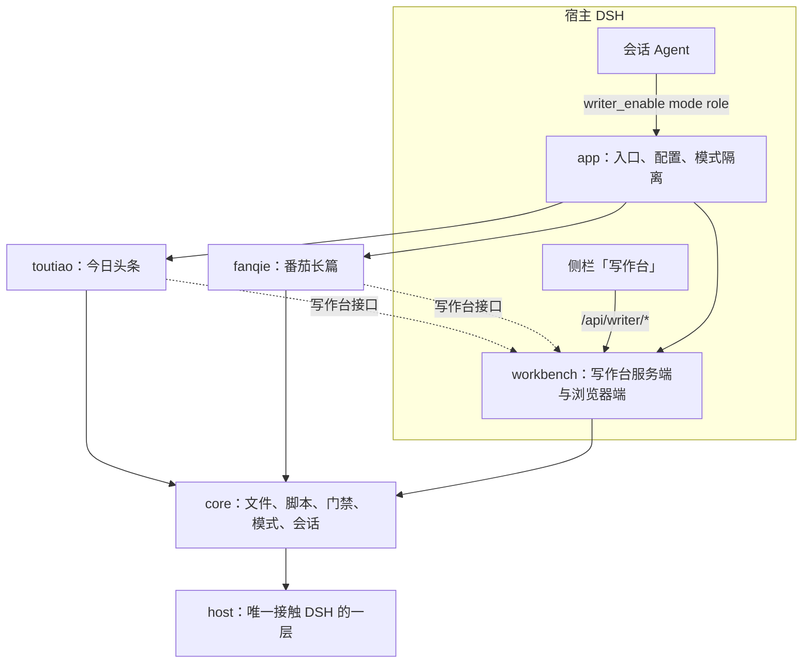

# 架构

写作 Agent 是一个 DSH 插件（包名 `dsh-writer`）：一个入口 `writer_enable`，两种写作模式，一个写作台。

## 包与分层

| 层 | 包 | 内容 |
|---|---|---|
| 0 | `host` | DSH 宿主对象的结构类型与能力探测：注册工具、段落、门禁、路由、会话投递；统一的工具返回形状 |
| 1 | `core` | 原子写与越界检查（fsx）、Python 运行器与 JSON 契约（runner）、门禁引擎（gates）、写作模式与隔离（mode）、会话追踪与投递（sessions）、版本 |
| 1 | `workbench` | 服务端：访问校验、限流、JSON 读写、路由组合（server.ts）；浏览器端：外壳与两种模式的界面（client/） |
| 2 | `toutiao` | 今日头条：19 个工具、总则、门禁、文章存储、规则脚本（skill/）、写作台接口（workbench/） |
| 2 | `fanqie` | 番茄长篇：引擎（engine/，作品存储与 50 多个创作工具）+ 写作层（forge 方法、章纲/旧账检查、编辑审读、门禁）+ 写作台接口（workbench/） |
| 3 | `app` | 插件入口：`writer_enable`、配置校验、把两种模式的接口挂到写作台 |

只能向下依赖；`scripts/architecture-guard.mjs` 还检查宿主边界、引擎存储边界、浏览器端边界和依赖环。

## 一次启用
1. Agent 调 `writer_enable(mode, role)`。`core/mode` 认领会话模式，冲突返回 CONFLICT。
2. 对应模式在调用方 Agent 作用域上注册工具、常驻段落、门禁（`tools/pre-execute`）。编辑角色只挂审读相关能力或拒绝写入。
3. 工具解析数据目录时，`core/sessions` 记下这个目录最近的主会话（子代理不记）。

## 写作台
- 浏览器端是一个 DSH 客户端模块（`build/client.js` → `bundle/dist/client.js`），模块 id = 包名。顶部切换番茄长篇 / 今日头条，两种模式各自取数。
- 服务端只有一个处理器：先做访问校验与限流，再按路径交给 `toutiaoApi` 或 `fanqieApi`。
- 按钮动作生成一条以【写作台】开头的消息，经 `core/sessions.deliver` 交给 DSH `sessionController.prompt`，排进该数据目录的主会话（Agent 忙时排队）。

## 数据
| 模式 | 默认位置 | 内容 |
|---|---|---|
| 今日头条 | `<会话目录>/outputs/toutiao/` | 每篇一个目录：meta.json、立项卡、只增不改的稿件版本、三联表、交稿单；台账 log.csv；反馈 feedback.md |
| 番茄长篇 | `<会话目录>/.writer/` | works/（每本书：章纲、正文、候选、历史、写作层审读回报 writer-reviews/）、library/、分析与灵感；详见 [engine/DATA.md](engine/DATA.md) |
| 会话记录 | `$DSH_HOME/writer-sessions.json` | 每个数据目录最近的主会话，供写作台投递 |

## 构建
- 一份 `tsconfig.json` 编译全部服务端代码到 `build/`；`scripts/build-client.mjs` 用 esbuild 打浏览器端。
- `scripts/build-bundle.mjs` 把入口打成单文件 ESM（`bundle/dist/index.js`，无运行时依赖），复制浏览器端、规则脚本与方法文件、备份脚本；`npm run pack` 生成 tgz。
