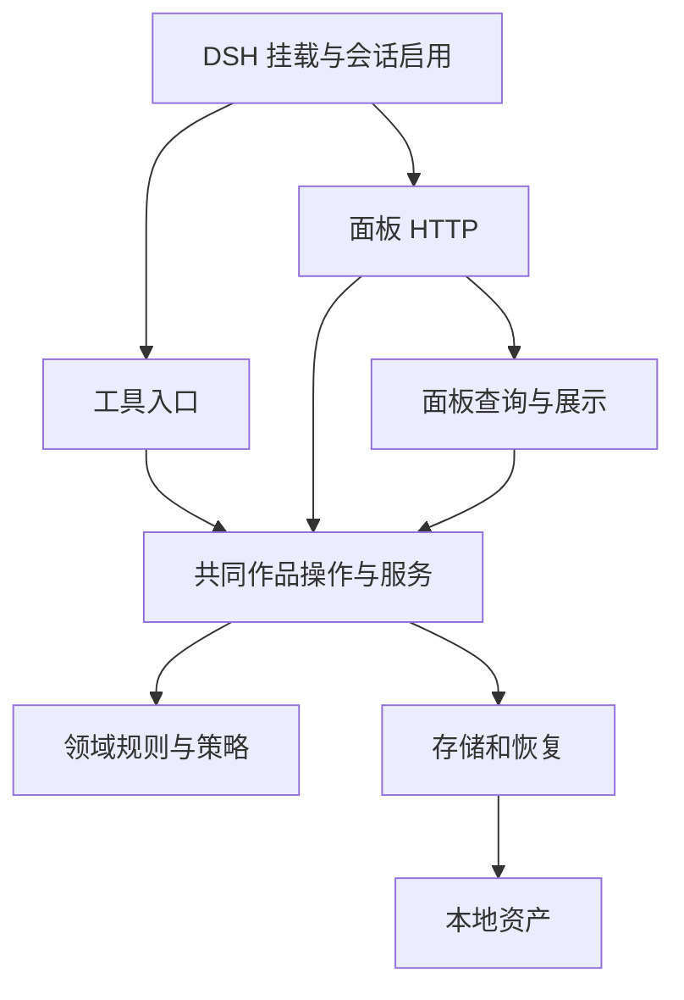

# 架构说明

织章的入口是 DSH 工具和作者面板。两者调用共同作品操作，领域规则定义版本和含义，存储负责文件、锁、历史与恢复。查询单独投影现有数据，不决定写入授权。

箭头表示调用或依赖方向；工具通过公开 Store 外观兼容现有接口，内部持久化不反向依赖查询或 Ports。

## 模块职责

| 路径（相对于 `src/`） | 责任 |
| --- | --- |
| `index.ts`、`lib/bootstrap.ts` | 挂载启用入口，向 Agent 作用域注册工具及必要提示 |
| `tools/` | 参数、回执和调用编排，不复制章节状态或恢复规则 |
| `tools/context.ts`、`lib/ports/config.ts` | 调用作用域配置及会话作品，隔离多宿主实例 |
| `lib/store.ts` | 稳定公开外观，重导出作品操作和查询接口 |
| `lib/work-store.ts` | 路径发现、作品、候选、留痕与汇编 |
| `lib/storage/chapters.ts` | 共同章节准备和保存、基线、审读、定稿、修订影响 |
| `lib/domain/` | 内容与上下文身份、证据、规划、章号、覆盖和工作流规则 |
| `lib/services/` | 工具/面板共用采纳、前章上下文及局部参考分析 |
| `lib/ports/` | 参考库、拆书、规划、方法、编辑和质量策略 |
| `lib/storage/` | 原子文件操作、资源锁、不可覆盖历史、各类恢复意图 |
| `lib/panel-query.ts`、`panel-enrich.ts`、`panel-html.ts` | 作者视图投影与展示，控制注入规模 |
| `lib/config-schema.ts` | 导出给宿主校验的插件 `Config`（Standard Schema；宿主提供 Schemastery 时使用之） |
| `lib/http-api.ts` | 面板接口、访问检查和按需正文读取 |
| `client/` | 浏览器半侧：`index.jsx` 登记席位，`useWorkbench.js` 与 `state.js` 管理数据与视图状态，`useDiagnostics.js` 管理扫描与保存请求，`edit-state.js` 管理纯编辑状态，`components/` 渲染界面，`ui.jsx` 适配宿主控件，`styles.css` 只用 `--dsw-*` 主题变量；由 `scripts/build-client.mjs` 打包为 `dist/client.js` |

## 一次写入如何成立

共同操作在合作资源锁内读取实际资产，核必要基线、来源和授权参数，准备已知目标，再记录多文件意图并执行。成功、未写入而拒绝，以及保留待恢复记录的部分状态，需要分别报告。

`recovery-common.ts` 提供快照、所有者核对和公共执行器。各 journal 保留自己的格式、固定目标和来源守卫；五类协议共用执行器，导入暂存、卡来源守卫和删除等仍有专用步骤。它们不是一套任意路径事务接口。

同一章节的直接保存和候选采纳共用准备逻辑，只有一份现行正文。修订先保留原字节历史，再提交现行变更。兼容旧格式时不猜造审读、阅读或授权证据。

## 查询与上下文

面板快照返回摘要，正文按需读取；HTML 和 JSON 复用共同投影。章简报按本章与明确关联选择材料，既保留实际前章正文，也控制无关全书索引的注入。缓存有条目和近似字节上限，但不作为采纳或恢复的完整性证据。

客户端请求按项目、作品和章节隔离；reducer 忽略旧选择的迟到响应，手动刷新使正文缓存失效。章节 lens 缓存暴露正文 revision 和完整读记录指纹，摘要批量读取、单次检查恢复状态，同时检测正文及审读元数据变化；写入仍重新读盘核基线。确认弹窗保留打开时的作品与已读版本，写请求完成后对账。插件详情卡遵循官方 `subject.pkg.name` 结构，控件在加载时选择宿主或本地实现，渲染错误由页面错误边界报告。

## 护栏与边界

TypeScript 使用 strict、`verbatimModuleSyntax`、未使用声明与参数检查。架构脚本解析可识别的运行时导入、导出和字面量动态导入，拒绝循环、存储反向依赖及关闭类型检查。它不证明外部宿主所有动态行为。

合作锁不隔绝任意外部编辑，原子替换不是 compare-and-swap，不保证断电持久性。插件不调用模型，也不自动验证文学质量。维护原则见 [CONTRIBUTING](../CONTRIBUTING.md)，具体操作前提见[业务契约](PORTS.md)。

`domain/diagnostics.ts` 只做文本分析，`services/diagnostics.ts` 负责读盘、源身份规范化与写入编排。表达诊断通过共同诊断服务捕获源版本，修订保存复用可重入作品锁与既有 stage journal。新修订显式绑定本次依据，避免继承过期简报；来源和去重字段随 lint、采纳继续保留。浏览器使用纯源位置解析与 React 文本节点，高亮不改作者字符串。当前只有快速扫描，无独立模型任务。

扫描请求随作品、章节、扫描对象和读取版本取消或隔离。保存请求不能因客户端取消而假定回滚；网络结果不确定时保留原请求与原修改、暂时锁定编辑，通过同一请求核对。撤销和重做分别限制步数与近似字节，不跨作品共享临时状态。候选读取版本使用文件属性触发刷新，写入完整性仍使用读盘内容哈希。

写作台请求 `snapshot?scope=work`，只读取作品、章节、候选及留痕；全书概况使用完整快照，额外读取参考与规划。HTML 报告保持完整范围。`buildPanelHints` 为简报提供提示，复用作品读取而不构建面板。界面模式变化会重新读取相应范围。

章节投影共用一个入口，最多 16 个文件并行；不可读章节明确标为 unavailable，不将异常伪装为空白成功。非核心参考库故障返回 unavailable 与原因，不补一套虚假的零计数结构。

当前客户端只登记 main、sidebar.panellist、plugins.detail.section 三种席位，生命周期交给 DSH fiber。宿主控件在加载时选择，不再包裹逐控件错误边界。真正需要的边界保留：可选宿主模块、资产格式兼容、版本冲突、幂等请求与中断恢复。
