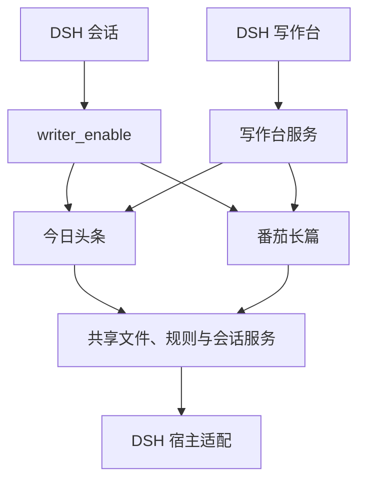

# 项目架构

`dsh-writer` 是 DSH 插件。DSH 管理模型、会话和工具执行；插件负责两种写作模式的数据、业务工具与写作台。

## 代码组织

| 目录 | 职责 |
| --- | --- |
| `packages/app` | 插件入口、配置校验、模式启用和装配 |
| `packages/host` | DSH 工具、提示段落、门禁、路由与会话投递适配 |
| `packages/core` | 文件、Python 运行器、门禁、模式与会话服务 |
| `packages/toutiao` | 头条文章、规则、工具和写作台接口 |
| `packages/fanqie` | 长篇引擎、forge 方法、审读和写作台接口 |
| `packages/workbench` | 写作台服务与浏览器界面 |
| `bundle` | DSH 插件包声明与构建产物 |

## 工作方式

Agent 调用 `writer_enable` 后，选中模式的工具和规则挂到当前会话。写作台读取相应数据目录；作者点击写作动作时，插件向该目录最近使用的主会话投递一条消息，后续执行由 DSH Agent 完成。

头条文章默认保存在会话目录下的 `outputs/toutiao/`；长篇作品默认保存在 `.writer/`。长篇正文、候选、章纲和审读各有自己的文件，具体布局见[数据与备份](engine/DATA.md)。

## 构建

`npm run build` 编译服务端和写作台客户端；`npm run bundle` 生成 DSH 插件目录；`npm run pack` 生成可安装的 tgz。测试与宿主接口见 [DSH 接口](DSH.md)。
