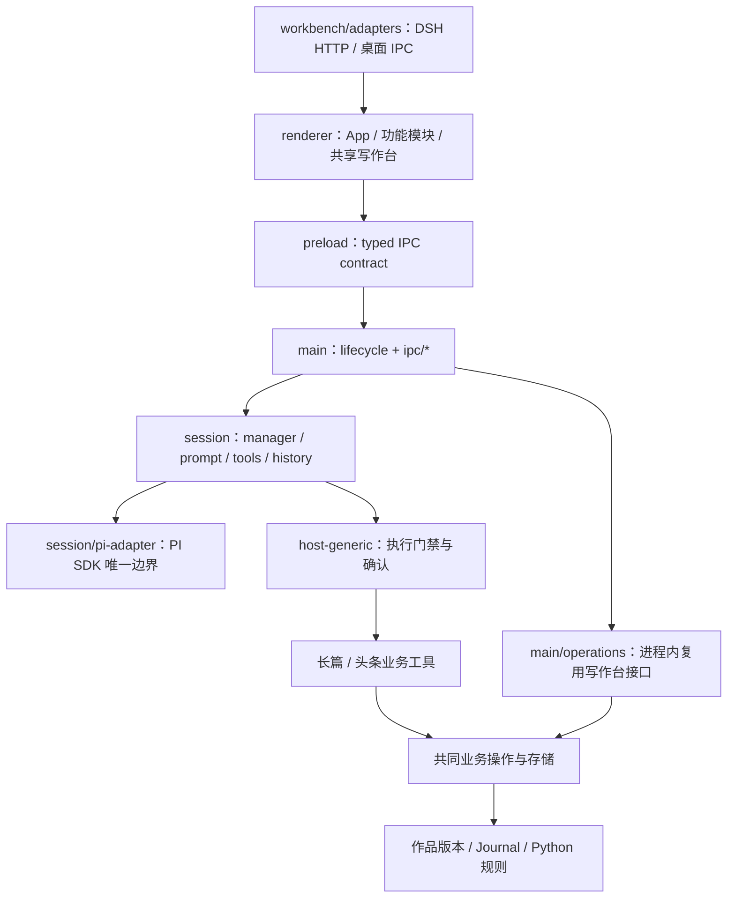
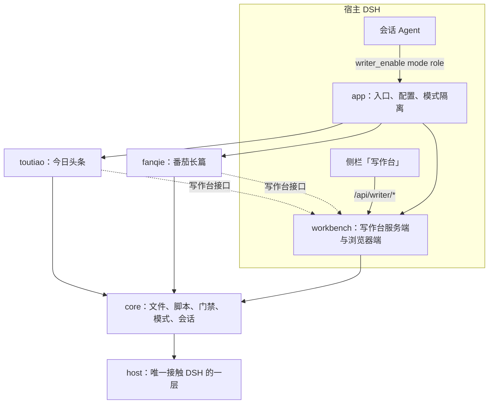

# 架构

写作 Agent 以基于内置 PI 的自有桌面客户端为主线，提供长篇和头条写作。现有 DSH 插件保留兼容，共用业务工厂、方法方案、门禁与本地作品；不增加其他 Agent 适配。桌面说明见 [DESKTOP.md](guides/DESKTOP.md)。

## 桌面调用链与事实归属

- **任务**：发送时捕获 Target/Focus；界面浏览位置与已接收任务分开。`session/` 按 manager、pi-adapter、prompt、delivery、history、editor-task、task-tracker 等模块管理准备、执行、主子会话和结果，`pi-adapter.ts` 是唯一 SDK 边界。子任务通过 `promptWithSignal` 将取消贯穿上下文准备与 SDK 启动，不从“当前未流式输出”推断任务已停止。
- **作者操作**：`main/operations.ts` 经 RouteContext 在进程内复用两种写作台接口，不额外启动 HTTP 服务；写入复用既有业务前提。`main/ipc/contract.ts` 统一通道、参数和返回类型，`renderer/state/desktop.ts` 是渲染层唯一的预加载桥入口。
- **写作台数据**：浏览器端经 `workbench/src/adapters` 的同名接口取数；DSH 用 HTTP 实现，桌面用 IPC 实现，视图不再自行拼请求。
- **授权**：本次确认绑定实际参数、对象和版本；共同执行门禁和敏感工具内部复核各有职责。UI 点头、模型文字和业务审读不是可以相互替代的授权。
- **作品**：正文、候选、规划和审读以磁盘实际对象及版本为准；结果卡和会话不另建作品事实库。原子写、资源锁、作品租约及 Journal 保护不同范围。
- **读取**：面板文件缓存和 PI 历史投影减少重复读取；授权、采纳及恢复依据仍核对实际文件。桌面写作台依赖事件刷新，兼容浏览器入口保留受控轮询。
- **方法**：原版、默认、用户方案承担不同用途；完整性登记、加载行为与发行路径分别核对，不能把不同方案当冗余删除。

当前工程收敛与验收要求见[下一轮迭代报告](history/NEXT-ITERATION-PLAN.md)。下文记录共享包边界及存量 DSH 接入。

## 包与分层

| 层 | 包 | 内容 |
|---|---|---|
| 0 | `host` | DSH 宿主对象的结构类型与能力探测：注册工具、段落、门禁、路由、会话投递；统一的工具返回形状 |
| 1 | `core` | 原子写与越界检查（fsx）、Python 运行器与 JSON 契约（runner）、门禁引擎（gates）、写作模式与隔离（mode）、会话追踪与投递（sessions）、版本 |
| 1 | `workbench` | 服务端：访问校验、限流、JSON 读写、路由组合（server.ts）；浏览器端：外壳与两种模式的界面（client/） |
| 2 | `toutiao` | 今日头条：19 个工具、总则、门禁、文章存储、规则脚本（skill/）、写作台接口（workbench/） |
| 2 | `fanqie` | 番茄长篇：引擎（engine/，作品存储与 50 多个创作工具）+ 写作层（forge 方法、章纲/旧账检查、编辑审读、门禁）+ 写作台接口（workbench/） |
| 2 | `host-generic` | 宿主无关的工具门禁、作者确认、配置绑定、执行与渲染；无 SDK 或网络依赖 |
| 3 | `app` | 插件入口：`writer_enable`、配置校验、把两种模式的接口挂到写作台 |

只能向下依赖；`scripts/architecture-guard.mjs` 还检查宿主边界、引擎存储边界、浏览器端边界和依赖环。

## 一次启用
1. Agent 调 `writer_enable(mode, role)`。`core/mode` 认领会话模式，冲突返回 CONFLICT。
2. 对应模式在调用方 Agent 作用域上注册工具、常驻段落、门禁（`tools/pre-execute`）。编辑角色只挂审读相关能力或拒绝写入。
3. 工具解析数据目录时，`core/sessions` 记下这个目录最近的主会话（子代理不记）。

## 写作台
- 浏览器端是一个 DSH 客户端模块（`build/client.js` → `bundle/dist/client.js`），模块 id = 包名。顶部切换番茄长篇 / 今日头条，两种模式各自取数。
- 服务端只有一个处理器：先做访问校验与限流，再按路径交给 `toutiaoApi` 或 `fanqieApi`。
- 按钮动作生成一条以【写作台】开头的消息，经 `core/sessions.deliver` 交给 DSH `sessionController.prompt`，排进该数据目录的主会话（Agent 忙时排队）。

## 数据
| 模式 | 默认位置 | 内容 |
|---|---|---|
| 今日头条 | `<会话目录>/outputs/toutiao/` | 每篇一个目录：meta.json、立项卡、只增不改的稿件版本、三联表、交稿单；台账 log.csv；反馈 feedback.md |
| 番茄长篇 | `<会话目录>/.writer/` | works/（每本书：章纲、正文、候选、历史、写作层审读回报 writer-reviews/）、library/、分析与灵感；详见 [engine/DATA.md](engine/DATA.md) |
| 会话记录 | `$DSH_HOME/writer-sessions.json` | 每个数据目录最近的主会话，供写作台投递 |

## 构建
- 一份 `tsconfig.json` 编译全部服务端代码到 `build/`；`scripts/build-client.mjs` 用 esbuild 打浏览器端。
- `scripts/build-bundle.mjs` 把入口打成单文件 ESM（`bundle/dist/index.js`，无运行时依赖），复制浏览器端、规则脚本与方法文件、备份脚本；`npm run pack` 生成 tgz。

## 独立桌面入口

`apps/desktop/src/session/pi-adapter.ts` 是唯一 Pi SDK 导入边界；`session/` 管理写手、独立编辑和规划角色、精简交接与既有会话文件。Electron main 由 `main/index.ts` 启动，IPC 按领域放在 `main/ipc/*`。渲染层是 `renderer/app` 组装、`renderer/state` 单 store 与 `renderer/features/*` 功能模块；React 工作区直接复用写作台组件。工具调用经 host-generic 回到原业务，不重建方法或存储。

统一根将书放在 novels、文章放在 toutiao、资料与作者偏好放在 .writer。跨入口的作品租约与轻量快照在 core，共享业务写入检查租约。0.9.3 继续基于内置 PI 完善自有客户端的会话、角色协作、上下文和作品一致性，见[开发计划](history/PLAN-0.9.3.md)；不新增其他 Agent 工具适配。
