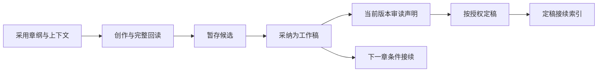

# 作品与生命周期

织章围绕同一部作品组织长期协作：保留作者意图，恢复当前现场，明确哪些材料可用于创作，记录采用与修订的范围。参考库、工具和面板都服务于这件事。

## 信息各自代表什么

| 材料 | 可以说明什么 | 不能自动说明什么 |
| --- | --- | --- |
| 作者目标、锁定与讲法 | 本书方向、边界和表达选择 | 已在故事里发生 |
| 参考原文、引文与分析 | 指定材料中的字句与带范围的解释 | 本书事实、市场效果或完整阅读 |
| 采用规划 | 当前允许用于创作的方案 | 剧情已经兑现 |
| 候选 | 一份可供比较和选择的表达 | 已替换现行正文 |
| 工作稿 | 当前采用的正文，可供后章条件接续 | 已审读、已定稿 |
| 定稿 | 作者允许保留的当前叙事版本 | 每句人物说法都是客观事实 |
| 简报、索引、摘要和诊断 | 带来源的辅助材料 | 可以反向改正文制造一致 |

作者决定目标、采用和定稿；AI 提交分析、规划、正文与审读声明；代码核对确定性条件、版本和文件；面板供作者阅读和操作。这些职责不要求由多个 Agent 分别承担。

## 从候选到定稿

章节状态为 `planned`、`drafting`、`drafted`、`reviewed` 和 `final`。状态名称不能代替证据：`reviewed` 要看具体审读结果，只有当前版本通过的声明才能用于定稿；`blocked` 仍是已记录的审读结果，但不允许据此定稿。

`stage` 保存候选，`accept` 应用工作稿。采纳内置机械扫描，不要求提前例行调用 `style_lint`。扫描记录只证明对某版执行了检测，不是文学质量结论。

## 连续写作与版本

简报保留章纲中的关键经历、人物知识边界、相关规划、前章实际正文、本书讲法和接续来源。前章未定稿可以继续连写，但须标为条件工作依据；后章定稿前核定实际依赖前章。超长正文被截断时必须补读，不能把摘要当作已经完整阅读。

正文、章纲和位置共同决定章节 revision。根基、规划和前稿另作为上下文依据绑定。即使本章字节未变，前面新增章节或必要依据变化，也可能使旧候选和审读不能继续应用。

## 修订过去的章节

修订先读现行稿、核基线，再保存或采纳。定稿正文修改需明确 `force=true`，旧文件原始字节另存历史，修改后降回草稿。重新审读与定稿不沿用旧正文结论。

系统提示已记录的依赖和可能需要核对的相邻章节，不推断全书全部隐含因果，不自动重写后文。确认修订影响只清除提示，不让过期候选和审读恢复有效。

`continuity.working` 与 `continuity.finalized` 是有版本来源的接续索引及末尾摘录，不是自动故事事实数据库。旧 `happened` 继续作为作者记录保留。

实际操作见[快速开始](QUICKSTART.md)，文件与冲突处理见[数据与恢复](DATA.md)。
