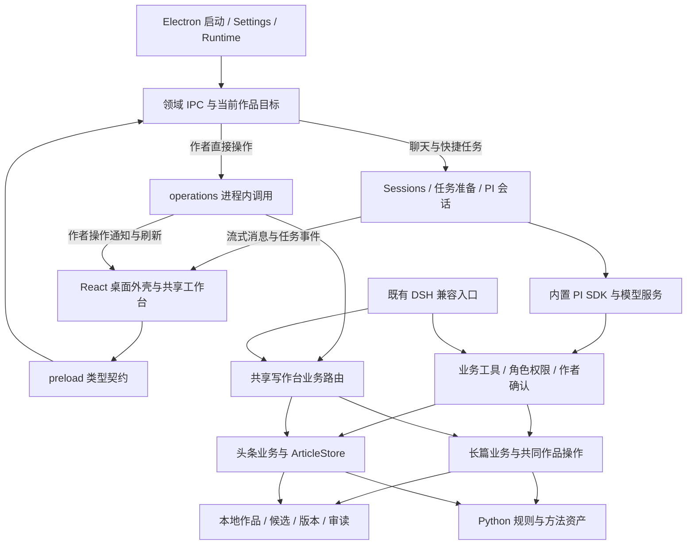

# 0.9.4 运行体系与精简审核

审核日期：2026-11-02（香港时间）。对应下一版：[0.9.5 迭代计划](PLAN-0.9.5.md)。

## 1. 基线与审核方法

- GitHub `master` 与本地均为 `eabd87a0b9a743cd468a09f4fc8cd38b07d75746`，工作区在审核开始时干净。
- 业务代码和 Windows 产物对应 `7a4f75b6c4d3ce312bcb547dec26b4ade6517916`；之后的 `eabd87a` 只更新 README 与验收说明。
- [0.9.4 构建 41327386013](https://github.com/ouzx6696-cmyk/dsh-zhizhang/actions/runs/41327386013) 已通过。GitHub 正式最新版仍为 v0.9.1；0.9.4 是已构建产物，不混同正式发布。
- 本轮采用全仓静态盘点、关键运行链路深读、风险与测试对应检查、少量定向复现。没有重新跑发行流程或真实模型矩阵，也不把静态盘点表述为逐行证明所有代码正确。

| 范围                      | 实际规模与口径                                                 |
| ------------------------- | -------------------------------------------------------------- |
| 桌面源码                  | 63 个 TS/TSX 文件，约 6,609 行                                 |
| 共享及业务源码            | 175 个 TS/JS/JSX 文件，约 24,644 行                            |
| JavaScript 测试与辅助代码 | 23 个文件，4,493 行，包含夹具、假模型和两个兼容 E2E 入口       |
| Python 检查入口           | 2 个文件，763 行；既有输出共 215 个检查项，并非 215 个独立流程 |
| 脚本                      | 15 个 MJS 文件，1,657 行                                       |
| 文档                      | docs 下 44 份 Markdown，不包含根 README 等文件                 |

AST 盘点 238 个运行源码文件：898 处显式 `any`、261 个 catch 子句、28 个无语句 catch；注释约 892 行，占运行源码行数约 2.9%。箭头形式 `.catch(() => …)` 不计入 catch 子句数。这些数字用于定位，不能直接当成缺陷数或删减指标。

**总体判断：主要负担集中在失败被正常化、角色与状态规则分散、运行时说明反复注入、检查与构建重复。普通代码注释和测试框架数量不是主要负担。**

## 2. 当前运行体系

### 2.1 启动、设置与目录

`main/index.ts → lifecycle.start()` 设置资源路径、状态根和方法方案根，加载界面、模型及业务配置，初始化诊断与 Sessions，恢复最近目标，然后注册 IPC、创建窗口、启用更新检查。

统一写作根中：`novels/` 放小说，`toutiao/` 放文章，`.writer/` 放资料、规划资源和作者偏好。Electron userData 放连接配置、会话与日志；方法方案根还可单独配置。既有作品目录通过登记索引继续使用。

模型 Key 经系统 safeStorage 加密；不可用时只保存在内存，并明确提示。这是合理降级。模型和业务配置坏了使用默认值时已有提示；作品、用户方法和会话索引不应照搬这种降级语义。

依据：[启动](../../apps/desktop/src/main/lifecycle.ts)、[设置](../../apps/desktop/src/settings.ts)、[目标选择](../../apps/desktop/src/main/targets.ts)。

### 2.2 界面、目标与任务对象

`App → useDesktopController` 组装桌面界面，`desktopStore` 保存系统、视图及焦点，`chatStore` 保存聊天与任务。流式正文使用选择订阅，输入框保留局部状态，已有性能收敛应保留。

长篇 `useFanqie` 管快照、章节和候选；头条 `useToutiao` 管列表、文章详情和操作。两者通过回调向桌面报告 Target/Focus。浏览位置、主进程当前作品、会话目标、发送时捕获的焦点是不同用途的状态，需要明确提交顺序。

共享界面通过 desktop IPC 适配器或既有 DSH HTTP 适配器取数。桌面没有为工作台再启动 HTTP 服务；用 RouteContext 复用现有业务是有效复用，不需要为清理工程重新造一套桌面业务。

### 2.3 一次模型任务

1. 聊天 `send` 或快捷动作 `request(.../deliver)` 捕获目标与焦点。
2. `Sessions.open` 按 mode/root/work 定位主会话，复用已开会话或恢复磁盘会话。
3. `taskPrompt` 读取当前方法方案、作品状态、审读和作者偏好；长篇写作任务还会调用 `chapter_brief` 留依据，此步骤含写入，不能视为纯读取。
4. `createSession` 组装角色工具、门禁和系统提示，经唯一的 `pi-adapter` 接入 SDK。
5. 业务工具经过角色检查、门禁、必要的作者确认、业务前提与存储约束，写入实际作品。
6. 主会话可用 `writer_review` / `writer_plan` 建立独立的临时子会话；子角色使用独立模型配置或规划跟随写手。
7. `task-tracker` 将 SDK 事件转换为任务进度、结果和消息身份，主进程向界面转发。
8. 停止涉及准备阶段、SDK 启动和父子会话；退出负责 abort、dispose 与释放自己持有的租约。

角色权限、准备阶段取消、会话打开去重各解决实际问题，不能因有多处判断而整体删除。当前工具定义量：长篇业务 60 个、头条业务 20 个；尚未加委派和来源工具。两者名称、说明与 schema 的 JSON 分别约 41,807 / 8,114 字符，属于模型上下文的实际固定成本，字符数不等同 token 数。

依据：[会话管理](../../apps/desktop/src/session/manager.ts)、[创建](../../apps/desktop/src/session/create.ts)、[任务上下文](../../apps/desktop/src/session/prompt.ts)、[工具执行](../../apps/desktop/src/session/tools.ts)。

### 2.4 长篇与头条业务闭环

**长篇：**资料分析和正式入库是不同入口，规划可直接使用已有材料；写作通常经过章纲、brief、候选、采纳为工作稿、审读声明及作者定稿。直接编辑正文也是受版本约束的入口。候选采纳的工具与工作台共同使用 `runAccept → acceptCandidate`；最终版本、定稿保护和写入在存储层复核。

长篇正文、章节目录、候选及留痕可能涉及多个文件，因此有进程内队列、短期资源写锁、journal 和恢复校验。前章依赖、规划依据和正文身份决定旧候选／审读是否仍适用，不能用“当前文件存在”代替。

**头条：**立项卡、逐版稿、质检、送验收、交稿单、台账及作者采用围绕 ArticleStore 展开。作者改稿新增版本，旧稿保留；0.9.4 新增版本与哈希条件保存。头条内部元数据更新使用进程内串行队列，作品租约阻止合作入口同时写入；没有长篇那套多文件 journal，不能在报告中宣称两者具备完全相同的恢复能力。

台账是派生信息：正文保存后台账同步失败应报告部分成功；作者采用入口目前仍吞掉同步失败，口径需要统一。

### 2.5 数据事实与保护职责

| 对象                     | 事实来源                     | 保护与边界                                             |
| ------------------------ | ---------------------------- | ------------------------------------------------------ |
| 正文、候选、立项卡、规划 | 本地作品文件                 | 版本／哈希、受控路径、原子写，长篇多文件操作加 journal |
| 审读、质检               | 与正文／立项卡绑定的保存回报 | 改稿后失效；诊断命中不等同文学判断                     |
| 主会话                   | PI 会话文件及 current 指针   | 聊天投影可缓存，作品事实须重新读取                     |
| 未保存编辑               | 编辑器内存                   | 离开决策、保存中阻止离开、冲突保留文本                 |
| 工作台列表／任务卡       | 派生视图                     | 不另建作品事实库；错误不能伪装成正常空态               |
| 作者确认                 | 当前动作、参数与版本         | 不能由模型说“已确认”替代真实授权                       |

作品租约负责“哪个进程持有作品”；资源写锁负责“一次写入互斥”；journal 负责“跨文件中断后的恢复”。三者职责不同。core 与长篇的两套原子写也有实际差异：后者包含链接检查与文件 sync，不适合仅因函数同名就合并。

## 3. 问题清单与证据

P1 为本版应优先修复的正确性／语义问题；P2 为本版收敛项；P3 为随相关修改处理的维护项。本轮未证实不可恢复的数据丢失，不据此虚构 P0。

| 编号 | 优先级 | 发现                                                 | 证据性质                                 |
| ---- | ------ | ---------------------------------------------------- | ---------------------------------------- |
| A01  | P1     | 作品选择提前提交状态，旧请求仍可覆盖新访问状态       | 源码与可控调度复现                       |
| A02  | P1     | 损坏头条文章静默从列表消失                           | 临时损坏文件、真实业务模块复现           |
| A03  | P1     | 固定方法损坏静默切默认；会话恢复吞没读取错误         | 方法问题已复现；会话为静态路径确认       |
| A04  | P1     | 默认解释文本被当作创作依据，改变诊断结果             | 真实规范化与诊断函数复现                 |
| A05  | P1     | 规划／编辑提示包含当前角色没有的委派指令             | 提示组装与工具注册交叉核对               |
| A06  | P2     | 错误在异常、字符串、对象和 exec.failure 间多次转换   | 源码调用链确认                           |
| A07  | P2     | 大量 any 与未检查共享 JSX，让内部默认值承担契约工作  | AST 与类型配置确认                       |
| A08  | P2     | 编辑保护、dirty 与确认分散，多种编辑器行为不同       | 源码链路确认                             |
| A09  | P2     | 同一任务结束触发两次工作台刷新                       | 事件生产与消费链静态确认，未宣称耗时收益 |
| A10  | P2     | 常驻说明、回执与持久化数据反复承载解释性／防御性文字 | 多个输出位置确认                         |
| A11  | P2     | 低价值镜像断言、文案锁定与串行 GUI 依赖削弱测试价值  | 测试源码核对                             |
| A12  | P2     | CI 选择范围过宽，运行时检查和构建重复                | 脚本及工作流核对                         |
| A13  | P2     | 守卫与检查的“通过”范围比名称暗示的窄                 | 配置与解析规则核对                       |
| A14  | P3     | 热点大文件、细碎包装与历史交付材料增加理解成本       | 职责与引用核对                           |

### A01：代际判断没有覆盖完整的目标切换

[targets.ts 第 59 行起](../../apps/desktop/src/main/targets.ts#L59) 只在修改 `state.target` 前检查一次代际，随后仍 await 旧租约释放、新租约申请和持久化。

定向复现结果：A 的租约申请延迟，B 先完成，A 随后返回时，最终 `target=/audit/B`，但 `access.owner=A-owner`、`readOnly=false`。另一次复现让新目录 claim 抛 EACCES，调用失败后 `state.target` 仍为新目录。前端 0.9.4 等待后端成功才更新，因而失败时可产生前后端分歧。

修复方向：在一个局部切换流程中明确准备、成功提交和旧资源释放；旧请求不得提交，新请求失败保留旧目标。可以复用既有串行工具，不新增通用事务系统。

### A02–A03：兜底改变了作者看到的事实

- [ArticleStore.list](../../packages/toutiao/src/store.ts#L140) 将目录错误变成空列表、单篇元数据错误变成 undefined；上层 [listArticles](../../packages/toutiao/src/workbench/data.ts#L32) 再 catch 后跳过整个根。临时放入合法文章 ID 和损坏 meta.json，得到正常空列表，无错误报告。未证实原文件被删除，缺陷是坏文章被隐藏。
- [activeProfile](../../packages/core/src/profiles.ts#L145) 把固定／已选方案查找错误一并吞掉。损坏 `fanqie/user-1/profile.json` 后，指定 `user-1` 得到 `{id:'default', pinned:false}`。作者的显式选择因此改变。
- [createSession](../../apps/desktop/src/session/create.ts#L44) 将 current 读取错误统一当作空值，access 失败统一当作不存在，随后新建会话。ENOENT 与权限／存储故障应该区分。
- [InspirationPort](../../packages/fanqie/src/engine/ports/inspiration.ts#L593) 的索引读取错误还会进入旧数据扫描，`resolveCraftCue` 又将所有失败变成空字符串；有“无卡”与“卡不可读”混同的同类问题，应随修复核对。

固定方案错误应明确报错；可选资源降级应携带具体原因；只有契约允许缺失且确认为缺失时才返回空值。不要把每个失败都包装成全局错误框，也不要继续用成功空态掩盖错误。

### A04：默认文字制造了“已有依据”

[library/schema.ts](../../packages/fanqie/src/engine/ports/library/schema.ts#L94) 在缺少 failAsTemplate 时填入 `DEFAULT_FAIL_AS_TEMPLATE`。该模板含“僵硬”，恰好匹配 `SHATTER_CRAFT_CUE_RE`。`craftCueFromHumanFeel` 再将它拼入 cue；[detectStiffnessTidy](../../packages/fanqie/src/engine/ports/human-feel-gate.ts#L221) 据此开启原本应由卡片实际内容触发的诊断。

复现：原始卡仅含物件描写、平静、窗边看雨和一处动作细节，`hasShatterCraftCue=false`；规范化后变为 true。同一段 153 字正文，诊断由 `[object_list_cold]` 变成 `[object_list_cold, stiffness_tidy]`。默认软警告已受到影响；显式 strictHuman 下还可能影响采纳，后者未在本轮另跑存储流程。

修复方向：缺失保持缺失；显示模板与创作依据分开。通用默认解释不得进入证据或条件判定。保留旧卡读取，不批量重写作者数据；需要的写法建议按任务给出。

### A05：角色提示与可用工具不一致

[systemPrompt](../../apps/desktop/src/session/prompt.ts#L28) 对非编辑角色直接使用写手总则，再给 planner 追加一句“不再派生子会话”。写手总则要求 `writer_review`；所有角色又追加了包含 `writer_plan` 的 CLIENT_NOTICE。实际 [createSession](../../apps/desktop/src/session/create.ts#L100) 只有 primary 才注册委派工具。

这是已确认的指令矛盾；尚未用真实模型测量其导致的额外轮次。三个角色应直接组装各自任务规则，共享部分只放共同事实，不靠末尾禁令覆盖前文指令。

### A06–A07：重复容错来自不清楚的内部契约

长篇 [defineTool](../../packages/fanqie/src/engine/tools/types.ts#L21) catch 后返回“错误”字符串，同时向 execution 写 failure；[executeTool](../../packages/host-generic/src/index.ts) 再识别 failure 或 ok=false 并重新抛错。`runAccept` 也把部分异常变为错误对象。头条主要用结构化 ToolFailure；主进程和适配器又处理 status/data/error/message。

同一失败因此有多种表达，且依赖字符串或可变 side channel。内部应保留一种可判别的错误语义，在 PI、HTTP、兼容入口最后一步各自转换外部格式，不一次性迁移全仓错误码。

898 处 any 主要集中在长篇 ports、分析、work-store；[适配器](../../packages/workbench/src/adapters/types.ts#L1) 仍以 `Json=any` 表示大部分返回值。桌面 strict 并未覆盖共享 JSX：`allowJs=true, checkJs=false`。先补作者写入、任务焦点、方案与结果这些关键接口，让内部能直接使用契约；不做全仓换语言或一次消灭所有 any 的工程。

### A08–A09：规则分散与重复执行

源码编辑、段落编辑、方法编辑分别管理 dirty/saving、beforeunload 与丢弃；桌面还有 [useDraftProtection](../../apps/desktop/src/renderer/app/useDraftProtection.ts)，共享界面另有 [useSourceGuard](../../packages/workbench/src/client/shared/useSourceGuard.js)。保护需求本身合理，重复的是离开策略与上下文传播。头条 dirty 进入 WorkspaceContext，却没有进入 `useToutiao` 报告的 Focus；任务上下文缺少与长篇相同的未保存标记。

更新安装又使用单独的“确认已保存”文字，[随后直接 dispose](../../apps/desktop/src/main/ipc/updates.ts#L39)，没有读取实际编辑保存状态。应与当前保存／离开规则衔接，不再加一层口头确认替代状态检查。

[task-tracker](../../apps/desktop/src/session/task-tracker.ts) 转发 agent_settled 后另发 refresh；[controller](../../apps/desktop/src/renderer/app/useDesktopController.ts#L176) 在 value.refresh 和 event.agent_settled 两处调用 refreshWorkspace。长篇第二次刷新还会中止前一次 inflight。收敛为一个刷新责任点即可，不新增事件总线或复杂调度器。

### A10：应精简的是重复说明和与事实混存的策略

- SYSTEM_BRIEF、写作层总则、Scheduler、AcceptPolicy 和采纳回执反复解释“扫描不等于质量／采纳不等于定稿”。首次规则说明及当前风险提醒有用途，每次成功都复述一遍会增加上下文成本。
- `QualityPolicy` 和工具输出向模型暴露 Gate、Port、旁路码等内部术语，作者需要的是当前结果与下一步。
- [chapters.ts 第 260 行](../../packages/fanqie/src/engine/storage/chapters.ts#L260) 每次保存把固定 coverageNote 解释写入作品元数据；全仓只有这一处引用，属于可从写入路径移出的固定说明。
- 普通源码注释仅约 2.9%，不支持“注释普遍过多”的判断。解释不变量、SDK 取消时机、版本默认值等非显然原因的注释应保留。

建议成功回执只包含实际结果、当前有效告警和一个必要下一步；原理放方法说明与开发文档。模型提示保留来源、权限和版本边界，给出直接任务动作。需要真实写作对比后，才能评价文风收益。

### A11–A13：测试和守卫的成本与盲区

已有核心 97 项、桌面运行时 9 项、GUI 6 场景和兼容运行时 1 项；Node 与 Playwright 各有实际用途，无覆盖率平台、自动重试矩阵或新测试框架。不能仅从数量判断体系过度。

具体问题：

1. [ui-status.test](../../test/ui-status.test.mjs) 大量断言逐项复述映射表，并将陌生英文状态显示为“草稿”固化；这是低价值镜像与不理想降级，应由少量真实状态呈现断言覆盖。
2. [Python 规则检查尾部](../../packages/toutiao/skill/tests/test_gates.py#L612) 锁定具体文案、日期和 CHANGELOG 措辞。资产完整性、枚举与规则契约应保留，编辑性表达不应成为运行正确性的条件。原版资产不要为精简测试随意修改。
3. 方法、方案、manifest 检查有重复遍历，但目录存在、实际可加载、发行资产完整性保护不同故障；去重应明确各自职责，不能整组删掉。
4. GUI 六项使用同一应用和串行状态，首次失败可让后续关键编辑场景跳过。应在现有场景内隔离关键编辑准备，保持场景数，避免共享一整条前序剧情。
5. Linux 和 Windows [各跑同一桌面运行时套件](../../.github/workflows/ci.yml#L44)；跨平台租约有价值，但大部分模型工具链不必重复。`shared` 把全部 packages/scripts/test 修改都视为兼容变化，单改 UI 也触发完整 DSH 与 E2E。
6. 核心 test:node 先构建完整兼容 bundle；兼容 job 随后 pack 重建；手动发行 Windows 又 pack。NSIS 和 ZIP 分开启动 builder／准备 Python。先去掉同一工作空间的重复准备，再决定跨 job 是否值得共享产物，避免为省一次小构建引入复杂缓存。
7. CI 设置 `ignoreSnapshots=true`，截图断言在 CI 不执行；结构／布局通过不能记作像素验收通过。保留少量人工检查截图，按需要显式运行视觉比较。
8. ESLint 全部为 warn，已有 17 项 Hook 告警；lint 成功不代表检查约束生效。关键正确性规则可升 error，依赖告警逐项核实，不能盲目补 deps 造成循环。
9. 架构守卫对 JSX 引用处理与其他源码不同，并跳过 client 的依赖图边；相对目标只把 `.js` 改 `.ts`，没有补齐无扩展名路径或按真实 TSX 解析。其依赖环结论不能覆盖全部 renderer/client。400 行提示还漏掉主要长篇大文件；无提示不等于职责清楚。

### A14：局部收敛有价值，全面再拆层没有依据

主要热点为 work-store 1,058 行、LibraryPort 1,011 行、workbench/api 919 行、tools/library 860 行、InspirationPort 771 行。部分所谓 Port 同时负责策略、文件、journal、兼容和回执；另一部分只是两三个转调方法。维护者沿一次业务调用需要跨多份文件寻找规则。

按本轮实际改动收拢目标选择、错误转换、回执和查询，保留已有稳定存储格式。不要为了 400 行阈值拆更多文件，也不应因为多个 journal 外形相似就引入通用事务 DSL。

[CI 交付整理](../../.github/workflows/ci.yml#L148) 仍固定附带 0.9.3 和 NEXT-ITERATION 历史计划。这是 Actions 交付附件，并非已证实进入安装包运行资源；可改为当前版本说明、使用指南及校验材料。历史文档在仓库中保留可追溯即可。

## 4. 清理取舍

| 处理         | 对象                                                                                                          |
| ------------ | ------------------------------------------------------------------------------------------------------------- |
| 优先修正     | 目标提前提交、损坏数据变空、显式方案被替换、默认文本制造依据、角色提示矛盾                                    |
| 合并收敛     | 失败格式转换、离开策略、任务结束刷新、同一工作空间重复构建                                                    |
| 移出日常路径 | 完整方法对比矩阵、历史迭代附件、重复原则段落、编辑性文案断言                                                  |
| 保留         | 作者确认绑定、版本／哈希、定稿保护、租约与资源锁、原子写和 journal、准备阶段取消、外部 URL 边界、脚本输出契约 |
| 随改随收     | any 热点、单纯转发包装、过期注释、真正重复的目录遍历                                                          |

“减少防御性编程”的具体执行标准：在真实输入边界验证，在内部用明确契约，在失败时表达真实状态；固定说明不参与事实推导。删除多余分支后，作者数据保护与可解释的失败应更可靠。

## 5. 本轮证据与结论边界

定向复现使用当前 targets.ts 源码转译并控制异步 I/O；损坏文章、损坏方案和默认 cue 使用 0.9.4 生成的真实业务模块及临时数据。结果分别记录了 target/access 错配、失败后目标改变、正常空列表、固定方案回落和额外 stiffness_tidy 命中；没有接触作者作品。

既有 0.9.4 检查与原生打包结果继续有效。本轮发现说明现有检查没有覆盖这些特定边界，不撤销其已验证的其他事实。性能收益、模型额外轮次和文学质量不凭代码行数推断，0.9.5 应在修复后分别记录实际结果。
