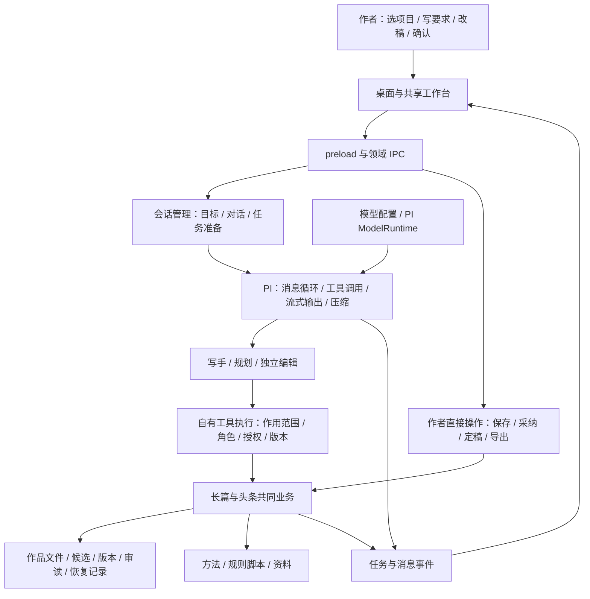

# 0.9.5 工作流、PI 内核与实测准备审核

日期：2026-11-02（香港时间）。对应方案：[0.9.6 迭代计划](PLAN-0.9.6.md)。

## 1. 基线与结论

GitHub master 与本地均为 `8834aaf862dcfe33a30e74df212d93276d524f6d`；正式 v0.9.5 标签为 `ebfa2e8cfce9afc4680223b10eb5cfa96117941d`，两者运行代码一致。内置 SDK 为 `@earendil-works/pi-coding-agent@1.4.0`。

本轮按整体框架、模块职责、前端动作、后端实现及 PI 实际行为顺序审核；复用 0.9.5 的已发布构建记录，另用临时项目、本地假模型和真实 PI SDK 定向复现。Electron 核对使用当前环境的 0.9.5 构建。没有使用真实模型或作者作品，也没有重新跑整套发行检查。

| 需要回答的问题                | 当前判断                                                                                           |
| ----------------------------- | -------------------------------------------------------------------------------------------------- |
| 整体框架是否成立              | 成立：PI 管会话与模型循环，自有业务管作品和授权，桌面复用共同业务                                  |
| PI 是否已经完整适配写作工作流 | 基础链路接通；任务作用范围、准备阶段、版本依据及隐式 SDK 配置仍有缺口                              |
| 会话隔离是否做好              | 不同小说的历史可分开；头条按整个目录共享会话，历史浏览也没有完整隔离实时事件与任务动作             |
| 项目隔离是否做好              | 存储锁与路径校验存在，但会话目标没有成为工具读写的强约束；不同路径身份和目录登记仍可能混用         |
| 能否直接上手                  | 单作品演示链可用，已有原生启动证据；多项目、并行改稿和完整角色首次配置应先修复，再进入真实项目试用 |

**0.9.6 应以“真实项目测试前的工作流闭合”为目标。保留 PI 和现有分层，把项目、作品、对话、任务、稿件版本贯通到每次操作。**

## 2. 整体认知框架

### 2.1 五个对象的关系

| 对象         | 含义                             | 当前实现                                                    |
| ------------ | -------------------------------- | ----------------------------------------------------------- |
| 写作根／项目 | 一组作品、资料和目录配置         | 统一根下 novels、toutiao、.writer；另有已知目录登记         |
| 作品         | 一部小说或一篇文章               | 小说用 work；文章用 id，但文章目前只放在 Focus              |
| 对话         | 围绕作品的一段聊天及其历史       | 小说按 mode/root/work 建会话目录；新对话保存旧 PI 文件入口  |
| 任务         | 一次发送、排队、委派、执行到结束 | 当前主要依赖 SDK 是否 idle、全局 preparation 集合和目标代际 |
| 稿件依据     | 本次操作读取的正文／候选版本     | 作者编辑已有版本条件；Agent 部分写入仍没有同等条件          |

当前最主要的问题是：**这些对象存在于不同层，却没有始终作为同一条操作链的约束。** 作品锁只能说明进程是否持有目录，不能说明某个会话应该操作哪本书；历史分文件也不能阻止工具参数指向别的作品。

### 2.2 合理的共享范围

模型连接、原版／默认方法库可以是应用级共享；作者偏好可以按统一写作根共享；某项目明确选择的参考资料可以被该项目读取。作品正文、私有对话、未提交要求和任务写入范围应有各自归属。

方法库共享与执行中切换方案也要区分：当前方法选择按模式保存在全局 active.json，任务提示捕获的方案与随后方法工具实际读取的方案可能不同。本轮静态确认了这条动态读取路径，未另做并发方案切换复现；0.9.6 应明确“本次任务用哪套方案，切换何时生效”。

## 3. 模块功能与可用状态

| 模块         | 已有功能与责任                                     | 0.9.6 需要补齐                                           |
| ------------ | -------------------------------------------------- | -------------------------------------------------------- |
| 项目与工作区 | 统一根、旧目录打开、作品列表、租约、最近目标       | 一致的物理目录身份；工具不能改写登记到别的项目           |
| PI 主会话    | 真实 SDK、主会话复用、历史文件、流式消息、工具循环 | 任务范围与生命周期由客户端明确管理                       |
| 规划角色     | 独立上下文、规划／资料工具、保存回执               | 保存必须归属本次作品；首次创建后明确绑定新作品           |
| 独立编辑     | 独立上下文和模型、编辑权限、有效回报核对           | 模型就绪检查；明确审读正式工作稿还是候选                 |
| 长篇         | 根基、章纲、brief、候选、采纳、审读、定稿、接续    | 默认工具 scope；模型与作者并行修改的依据贯通             |
| 头条         | 立项、标题、逐版稿、质检、采用、交稿单、台账       | 每篇文章的会话与任务归属；Agent 存稿条件                 |
| 稿纸与修订   | 源码编辑、段落修订、冲突保稿、候选对照             | 目标、未保存状态与任务状态统一呈现                       |
| 方法与资料   | 默认／原版／用户方案、拆书库、网页读取             | 共享范围可见；固定任务方法；屏蔽 SDK 隐式上下文          |
| 对话历史     | 新对话、旧对话查看、可见消息分页                   | 旧记录只读；实时流、快捷动作和对话身份一致               |
| 模型连接     | PI 发送请求，自建服务商预设、连接字段与角色配置    | 复用 PI 模型目录、API 类型、能力和思考映射；补齐模型选择 |
| 设置与上手   | 写手连接测试、写作根、角色设置                     | 写手／编辑共同就绪；空态入口可操作                       |
| 导出         | TXT、DOCX、复制；长篇导出已定稿章节                | 用实际作者流程检查定稿、导出和所见内容一致               |
| 备份与恢复   | 根目录备份、快照、部分长篇中断恢复                 | 重启后说明任务中断及已保存结果，不假装自动续跑           |
| 发行与运行   | Windows 包、随包 Python／字体、更新清单            | 0.9.5 → 0.9.6 的实机安装／升级与真实目录走查             |

长篇的原子写、journal、版本核对，头条逐版稿和作者保存条件继续保留。底层恢复分支本轮以 0.9.5 的记录为背景，没有将每个分支重新手测。

## 4. PI 适配核对

### 4.1 已成立的部分

- SDK 只从 pi-adapter 接入，自有工具、模型和角色提示可以明确组装。
- 自有工具白名单有效。复现中的长篇写手开放 63 个自有工具，未开放 PI 内置 bash/read/write/edit 等编码工具。
- 不同小说 work 的会话 key 不同。真实 SDK 请求中，B 的模型上下文没有出现 A 的私有聊天标记。
- 规划与编辑用新上下文，已有角色权限和作者确认；会话压缩、重试、用量统计由 SDK 提供基础能力。
- 作者直接操作和 Agent 写入复用已有业务，避免再造作品事实库。

### 4.2 还没有适配完整的部分

| 边界       | PI 的行为                                       | 客户端当前缺口                                 |
| ---------- | ----------------------------------------------- | ---------------------------------------------- |
| 工具能力   | 执行注册工具及参数                              | 会话绑定 work 只是默认值，工具参数可以覆盖     |
| SDK idle   | 表达 SDK 当前运行／压缩状态                     | 不包含本应用尚未完成的上下文准备               |
| followUp   | 可以在运行时排队                                | 客户端未完整表达每个排队任务的身份、对象与取消 |
| 压缩与重试 | 依赖 SettingsManager                            | 客户端没有完全拥有配置来源和生命周期呈现       |
| 资源加载   | 关闭 skills/extensions 不等于关闭 context files | 仍可能把 AGENTS 和 .pi/settings 带进写作内核   |
| 对话历史   | SDK 按会话文件组织消息                          | UI 只按作品过滤事件，缺少当前／历史对话边界    |
| 稿件更新   | SDK 不理解作者改稿版本                          | 必须由共同业务和写入参数提供版本条件           |

PI 是可继续使用的执行基础。这些缺口应在我们自己的适配边界修复，没有依据为 0.9.6 更换内核。

### 4.3 模型适配应精简复用 PI

当前适配器已经调用 PI 的 ModelRuntime，发送层无需重写。问题在于配置和模型描述仍由桌面重复维护，未把 PI 已有能力接到作者界面。以下核对依据为实际安装的 PI 1.4.0 源码、类型和随包文档，没有另行调用外部模型服务。

| 作者需要的能力 | PI 现有能力                                                                                   | 本产品应承担的部分                                                   |
| -------------- | --------------------------------------------------------------------------------------------- | -------------------------------------------------------------------- |
| 地址与端口     | provider／model 的 baseUrl，由对应 API 实现构造请求                                           | 一个完整地址输入及协议对应示例，保留端口和代理路径                   |
| 选择接口       | 原生支持 Chat Completions、Responses、Anthropic Messages、Google 等 API                       | 常用类型中文选择；目录模型默认沿用其 API，其他能力按需展示           |
| 选择和抓取模型 | ModelRuntime.getModels／getAvailable／refresh，内置目录与缓存；动态 provider 的 refreshModels | 可搜索的模型列表和刷新入口；自定义端点缺少发现实现时仅补最小请求解析 |
| 上下文与输出   | 模型 contextWindow、maxTokens 及覆盖配置                                                      | 默认采用目录元数据，允许显式覆盖；未知能力不当成已验证容量           |
| 思考强度       | getSupportedThinkingLevels、clampThinkingLevel、thinkingLevelMap；会话也提供可用档位查询      | 只展示实际支持的档位，显示最终生效值，保留模型映射                   |
| 协议差异与请求 | PI 的 compat、消息转换、工具调用、流式输出和取消                                              | 传递经过配置的能力与兼容字段，保持单一 SDK 接入边界                  |

需要区分三件事：PI 公共目录刷新、服务商本身的动态列表、自定义网关的模型抓取。`refresh` 不能被描述为自动请求任意网关的 `/models`；仅有模型 ID 的列表也不能证明上下文容量、思考能力或账号调用权限。没有发现接口的连接仍可手填模型。

目录中已有的模型描述、thinkingLevelMap 和兼容字段应保留到运行时，不能统一替换成一份只含手填容量和 reasoning 开关的模型对象。模型连接继续由本应用显式配置，F05 的项目隐式设置仍需关闭。

## 5. 已确认的问题（区分实际复现与静态核对）

所有运行复现均在临时目录中进行。原始记录保存在本次工作环境的 `/workspace/analysis/review-0.9.6/`；以下记录说明触发条件、实际结果和代码位置。F10 为随后补充的源码与 SDK 能力核对。

### F01：小说会话分开，但写入范围没有锁定到作品（阻断实测）

真实 PI 会话绑定 A 作品，模型调用 `fanqie_chapter_save(work='b')` 后，B 正文实际被修改。A、B 的会话 key 本来不同，B 请求也没有 A 的私有历史。

原因：[session/tools.ts](../../apps/desktop/src/session/tools.ts#L72) 将绑定 work 放在前面，再展开模型 args，后者覆盖前者。角色权限检查只限制工具名；[openWork](../../packages/fanqie/src/engine/tools/context.ts#L91) 接受实际传入的作品。租约按进程判断，本进程能写 B 不代表 A 会话获准操作 B。

### F02：working_dir 与作品根可以形成混合目录登记（阻断实测）

模型在项目 A 会话中传 `working_dir=B`。实际结果：B 原文件保持原稿，写入仍落在 A；但项目 B 的登记 `worksRoot` 变成 `A/works`。

原因：会话 config 保留 A 的 worksRoot，而 [storagePaths](../../packages/fanqie/src/engine/work-store.ts#L345) 又允许 working_dir 改变 base；[ensureStorage](../../packages/fanqie/src/engine/work-store.ts#L388) 随后登记了这个混合结果。这里证实的是路由和登记混用，不能把它误报成已覆盖 B 原文件。

### F03：头条文章共享整个目录的私有对话（阻断实测）

先给文章 one 发私有要求，再切文章 two 发任务。第二次真实模型请求仍包含 one 的聊天标记。

原因：[Sessions.key](../../apps/desktop/src/session/manager.ts#L52) 只有 mode/root/work；文章 id 在 Focus 中，不参与身份。它是当前明确的目录级会话设计，不能声称已有逐篇隔离。两篇文章切换时，当前对话、停止动作和新对话入口也随之共享。

### F04：任务准备阶段可以被释放后继续请求模型（阻断实测）

在真实会话创建完成、作者偏好读取尚未完成时暂停：`hasPending=true`，`running=[]`，SDK `isIdle=true`。调用现有 release 模拟切离作品后，再放行准备过程，结果为 `sessions.size=0`，但又发出了一次模型请求，send 没有报错。

原因：[delivery](../../apps/desktop/src/session/delivery.ts#L17) 的 preparation 只有全局集合；[release](../../apps/desktop/src/session/manager.ts#L147) 和 [newConversation](../../apps/desktop/src/session/history.ts#L23) 主要看 SDK idle。SDK dispose 不能代替应用对后续准备结果的取消和归属管理。

stop、模型设置重建、退出和新对话应统一覆盖准备到结束的完整任务；本轮直接复现的是 release 路径，其他入口按同一职责链纳入修复和验收。

### F05：SDK 隐式上下文仍能改变内核行为（阻断实测）

给临时项目放入 AGENTS 标记和 `.pi/settings.json` 的 `compaction.enabled=false` 后：写作会话 systemPrompt 包含该标记，实际 compaction 关闭。内置 shell 工具仍未开放。

[createSession](../../apps/desktop/src/session/create.ts#L103) 已关闭 extensions、skills 和 prompt templates，但没有关闭 context files，也没有显式提供 SettingsManager。已安装 SDK 的 `DefaultResourceLoader` 默认加载上下级 AGENTS，`createAgentSession` 默认从磁盘创建设置。

应明确写作内核的配置来源；这不是已经复现任意命令执行或权限绕过。

### F06：Agent 存稿可以把作者新版降成历史（阻断实测）

文章已有第一版，作者按条件保存第二版；随后执行基于第一版文本的实际 PI 注册存稿工具。结果为当前第三版是模型旧依据稿，作者第二版仍在历史中。

[toutiao_draft_stage](../../packages/toutiao/src/tools.ts#L225) 没有 expectedRev/哈希参数，调用 stageDraft 时没有传既有 expected 条件。0.9.5 的作者 UI 条件保存没有覆盖 Agent 写入。旧文件未被删除，但当前稿被旧依据推进。长篇直接保存也应核对同类依据，不能只约束候选采纳。

### F07：历史对话能显示当前流，并触发当前任务（阻断实测）

真实 Electron 查看旧对话时：发送按钮禁用，但“继续写作／派编辑审／检查本章”仍可用；点击派编辑后，真实当前会话收到模型请求。向相同作品送入一个受控的当前流式 IPC 事件，文字显示在旧对话下面，截图已记录。

[controller](../../apps/desktop/src/renderer/app/useDesktopController.ts#L156) 仅在 message_end 分支检查 archive；message_update、任务和 busy 仍更新聊天。快捷动作经 deliverAction，绕开 sendText 对历史模式的限制。历史只读应同时约束事件投影和所有发起任务的入口。

### F08：首次角色准备和恢复空态不闭合（上手前修复）

- 首次只配置通义写手时，normalizeModels 得到 writer 已有 Key、editor 仍为 DeepSeek 且无 Key。引导只测试写手，快捷投递能力也主要看写手 Key，因此不能保证首次审读可用。
- 真实 Electron 在已有模型和写作根、没有 target 的状态下显示“开始设置”，点击后引导没有打开。[App](../../apps/desktop/src/renderer/app/App.tsx#L52) 只设置 wizardStep，没有开启 onboarding。

应提供编辑跟随写手／单独配置的明确选择，并显示角色实际就绪状态。连接测试当前是 32 token 文本请求，不能由此推断流式工具调用及独立编辑均可用。

### F09：目录身份不一致（随作用范围一起修复）

同一物理目录通过软链接访问，Sessions.key 不同；它只做 path.resolve。[projectIdOf](../../packages/fanqie/src/engine/work-store.ts#L163) 则在所有平台转小写。会话身份、登记身份与租约的 realpath 身份不是同一口径。

这会造成同目录多会话；在大小写敏感文件系统上还可能合并实际不同的项目。软链接与 key 差异已复现，Windows 特定路径行为仍需该平台验收。修复时必须保留旧历史入口，不能换 key 后丢掉作者对话。

### F10：模型配置重复维护，PI 已有能力没有完整接入（本版必做，静态核对）

- [models.ts](../../apps/desktop/src/models.ts#L1) 自定义 Thinking 联合类型和两种 API 白名单，维护六个服务商的固定模型／容量预设。PI 1.4.0 已支持更多 API、模型目录和按模型计算的思考档位，包括仅部分模型支持的 max。
- [ModelFields](../../apps/desktop/src/renderer/features/settings/ModelFields.tsx#L16) 只能选服务商和手填模型 ID，没有 API 类型选择或模型抓取入口；思考档位固定列出 off 到 xhigh。端口本来可以写入 baseUrl，不应误报为不支持端口，实际缺的是明确的地址示例和接口语义。
- [runtimeModel](../../apps/desktop/src/session/pi-adapter.ts#L52) 每个角色注册一个合成 provider，并重新拼装模型对象。它使用手填容量、reasoning、统一的零费用，没有带入目录模型的 thinkingLevelMap、compat 等元数据。PI 对部分地址仍有内置兼容判断，不能据此声称所有兼容能力都失效。
- 现有连接检查只做短文本请求；“可枚举／有凭据”和“当前连接能完成写作所需的工具循环”应分别说明。

应保留桌面设置、角色选择和必要的旧配置转换，其余优先直接调用 PI。无需复制 PI 终端界面、重新写协议适配器或扩张完整登录体系。

## 6. 前端动作与后端语义核对

| 作者动作                | 当前实际路径                                                     | 0.9.6 要求                                                |
| ----------------------- | ---------------------------------------------------------------- | --------------------------------------------------------- |
| 新建小说／文章          | 先进入无作品目标，模型再创建；小说创建后关联会话，文章缺对应绑定 | 创建中任务有稳定身份，成功后只绑定实际新作品              |
| 切到另一作品            | UI、main target、任务和租约分开更新                              | 浏览切换可继续，原任务仍可见、可停止且不能改写新目标      |
| 输入追加要求            | PI followUp 排队                                                 | 显示排队对象及状态，切换页面不重定向已接受任务            |
| 派编辑                  | 快捷请求只传 chapter/article；候选信息不进入委派契约             | 明确审读对象和版本，回报对应实际稿件                      |
| 查看旧对话              | 消息主列表读取历史，实时事件仍可更新该聊天                       | 只读历史与当前任务分开，提供“返回当前对话”                |
| 作者改稿同时 Agent 写稿 | UI 有版本条件，Agent 部分入口没有                                | 保存／采纳核原依据；冲突保留作者稿和模型候选              |
| 修改方法或模型          | 模型保存会 dispose 会话；方案选择按模式共享                      | 任务影响提前明确；设置变更不产生游离准备任务              |
| 重启应用                | 恢复目标和会话文件，任务运行状态重新开始                         | 说明上次任务已中断与已保存内容，恢复后由作者继续          |
| 导出／升级              | 已有确认和版本清单                                               | 用真实 Windows 目录完成一次从编辑、定稿到导出及升级的走查 |

审读目标还存在静态语义风险：候选视图中的快捷审读丢掉 candidate 信息，writer_review 也只定义 work/chapter/article；reviewResult 核的是当前章节正文。0.9.6 可以采用最小路线：明确“审读当前工作稿”，候选先经作者采纳为工作稿再审。没有必要为这一版另建完整候选审读存储体系。

## 7. 0.9.6 的进入实测条件

目前应先完成 F01–F07 的作用范围、生命周期、版本及历史边界修复，并闭合 F08 上手入口；F09 与身份设计一并完成，F10 纳入 PI 适配与首次配置。保留现有工作台布局、PI SDK、业务存储和必要保护。

验证分三类：业务版本与目录、PI 隔离与任务、GUI 作者动作。复用现有夹具和少量场景，不建立新的测试平台或全模型矩阵。

0.9.6 交付时需给出具体实测路径、已执行证据和剩余条件，用户随后用真实项目评估文学质量、长周期稳定性和实际费用。短假模型结果支持流程判断，不能证明真实模型会始终正确选择工具或写出合格作品。
