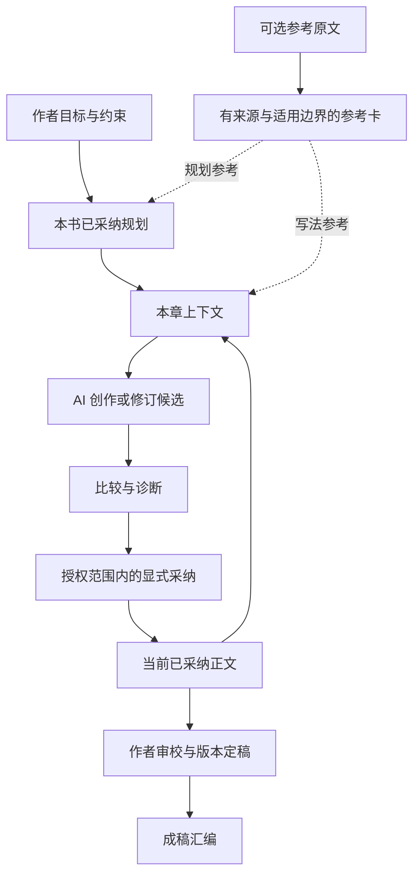

> 档案快照：保留当时的分析、计划或验证记录，不作为当前安装与使用要求。当前说明见[文档导航](../README.md)，版本变化见[CHANGELOG](../../CHANGELOG.md)。

# 整体认知与系统评估 · 2026-10-27

> 历史评估：描述 0.17.0 基线及当时的问题，不是当前实现声明。0.18.0 实施与验证以 [IMPLEMENTATION.md](IMPLEMENTATION.md) 为准。

评估基线：提交 `cfc93a2891fa3b3d60bf36697f7d452cb7b1e6e1`，版本 0.17.0。先依据项目目标、信息流、决策权和作品生命周期建立整体模型，再判断模块职责。文中的目标边界是设计建议，不表示已经实现。后半部分保留隔离验证的局部证据，没有修改业务实现。

## 总体判断

织章的核心价值是：让作者与 AI 能在长篇创作中持续协作，跨会话保留意图、参考依据、当前作品和待选方案，降低遗忘、误采纳、续写失接与修订失控的成本。拆书、灵感、写作和面板都应围绕这件事组织。

主流程已贯通，按需启用、作者控制、工程与创作分工、工具与面板共用采纳服务值得保留。整体短板是：跨环节的内容身份、授权范围、修订影响和提交结果还没有形成足够统一的规则。各入口因此逐步积累自己的保护和恢复逻辑，物理拆分不能独自消除这些分歧。

## 一、项目要解决的根本问题

长篇写作会同时累积四种负担：作者意图在会话中丢失，参考分析被误当成作品设定，计划与已写事实逐渐不一致，修订使旧的摘要和审校判断过时。织章应把这些负担变成可见、可核对、可继续的工作现场。

据此衡量产品价值，应看作者能否快速恢复现场、AI 能否获得必要且准确的上下文、被采纳的内容能否安全演进，以及这些保障是否增加了过多操作。工具数量、字段数量、门禁数量和文件数量都只能是实现手段。

需要支持四种完整使用情境：

1. 作者只有新想法，没有参考书，直接规划并开写。
2. 作者先研究参考书，再把可迁移方法用于自己的作品。
3. 作者带着已有作品回来，恢复现场并续写。
4. 作者改动已写章节或规划，核对受影响的信息后继续创作。

前三种情境已有主线支撑，第四种的影响传播较弱。把拆书到采纳画成单向流水线，不能充分解释这个产品。

## 二、信息的身份与决定权

“单一事实源”需要按问题分别确定，不能把所有信息都提升为同等权威，也不能把它理解成所有内容放进一个文件。

| 信息身份 | 回答什么问题 | 权威及边界 |
| --- | --- | --- |
| 作者目标与锁定 | 本书想写什么，哪些约束应遵守 | 表达创作意图；与正文冲突时提示作者核对 |
| 参考原文与阅读记录 | 分析依据来自哪里，实际交付或申报到何处 | 只描述参考材料及阅读过程，不构成本书事实 |
| 技法与思维卡 | 哪种办法可能有效，在什么条件下失效 | 属于有来源的解释与建议，引用命中不证明解释正确 |
| 已采纳规划 | 作者目前打算怎样发展 | 具有指导作用，不代表这些情节已经发生 |
| 当前采纳正文 | 目前作品实际写成什么 | 是当前故事表达的主要依据；与锁定矛盾不能自动改写任一方 |
| 待选候选 | 有哪些尚未应用的改写或发展方案 | 可以持久保存供比较，不能因此进入当前作品 |
| 摘要、简报和诊断 | 怎样压缩现场、辅助下一步判断 | 需要关联来源版本，不能悄悄代替正文与作者判断 |
| 留痕、索引和面板 | 做过什么，怎样发现和浏览内容 | 操作记录与查询结果各有职责，不承担故事事实判断 |

需要纠正文档中“accept 才持久化”的过度简化：stage 本身已经保存候选。准确的共同规则是“保存方案”和“把方案应用到当前作品”必须有清楚区别。

作者拥有目标、取舍和定稿的决定权；AI 负责提出创作与分析；代码负责确定性的约束、读写及可核验记录。工具中的显式采纳可在作者已有授权范围内执行，不能为了统一架构给每一步追加确认。成本扩张、覆盖定稿等超出原范围的行为才需要清楚表达额外授权。

## 三、真正需要闭合的业务循环

核心日常循环是“恢复现场 → 形成候选 → 比较判断 → 采纳 → 更新现场 → 下一章”。拆书库是可以跨作品复用的上游能力；作者无卡时，循环仍应成立。写作质量反馈可帮助人工修订参考卡，但当前没有证据支持把这种提升描述成已经自动实现的闭环。

创作上下文是关键连接点：它必须同时解释本章目标、已经写出的场面、作者约束、必要规划和选定写法，并清楚标明省略、缺失和版本。上下文编排值得成为明确职责，不应只是各工具拼接的长字符串。

## 四、贯穿全系统的规则

1. **证据范围不可被扩大。** 抽样、引文核对、阅读申报与分析判断分别表达；进入规划或写作后仍保留其参考身份。覆盖率加权分数是工程指标，不是分析正确率的概率。
2. **计划与实际分别维护。** 规划可以修改，正文可以偏离；偏离需要被看见，代码不能把纲末自动宣判成已经发生。
3. **应用内容必须明确。** 作者或授权的 Agent 采纳的是可识别的内容及目标；扫描凭据、编辑关系和基准版本不能错配。
4. **采纳与定稿分别表达。** 写进当前章节不等于作者审定；修改定稿正文后，新版本不能直接沿用旧版本的审定结论。
5. **成功与失败有共同含义。** 一次业务动作需要共同成立的文件作为一个提交单元；中断要能识别。若某类诊断记录只是附加信息，其失败应明确呈现，不能把已成功的正文写入报告成完全未发生。
6. **修订影响可见，自动改写克制。** 正文变化后，相关摘要、扫描与上下文可能需要更新；先提示核对，不自动重写后续章节，也不强制整书重跑。
7. **所有入口遵守相同领域规则。** 工具与面板可以有不同交互和认证方式，对定稿保护、应用内容和提交结果应得出一致结论。
8. **读取状态不可混淆。** 没有、不可读、待恢复、过期是不同状态，用户和 AI 都要能区别。

这些规则才是整体重构的约束。先建立它们与现有入口、存储及查询的对应关系，再设计修改，不能按错误所在文件逐个打补丁。

## 五、从整体规则推导模块边界

以下按职责描述目标，不要求立即改名或一对一增加目录。

| 职责 | 应拥有的规则 | 如何与其他部分交接 |
| --- | --- | --- |
| 参考知识 | 原文身份、阅读范围、证据位置、分析与卡的生命周期 | 输出带来源和适用范围的参考，不写本书事实 |
| 作品领域 | 目标、约束、规划、章节、候选、采纳与定稿的含义 | 提供明确的作品操作和版本状态 |
| 上下文编排 | 选择哪些当前信息进入本次创作，怎样压缩和标注 | 读取作品与可选参考，输出可追溯的本次上下文 |
| 创作诊断 | 可确定的证据检查及不确定的质量信号 | 返回信号与依据，由领域策略决定是否阻断 |
| 应用编排 | 授权范围、目标版本、业务操作需要共同提交的变化 | 连接领域规则和存储，不把业务判断分散给入口 |
| 文件存储与恢复 | 路径、文件格式、锁、原子替换、冲突和中断状态 | 执行已确定的写入意图，不决定什么叫好作品 |
| 交互与查询 | 工具参数、HTTP 访问、面板视图和用户回执 | 调用共同业务能力，不另建采纳或定稿规则 |

现有 Library、Inspiration、Writing 可以继续作为用户理解功能的分类。工程边界则要按上表核对：Inspiration 当前同时承载会话、参考分喂、规划应用和写入编排；Store 同时承载持久化与面板汇总。依赖回路与职责重复应从这里解释，而非仅凭文件较长就拆文件。

Scheduler 负责导航和推荐步骤，不能成为判断内容已完成的依据。QualityPolicy 负责表达目标与可调策略，词表不承担对创作语义的最终裁决。面板负责让作者看清现场并做决定，和工具共同使用作品操作。

## 六、用一次修订检验整体设计

假设作者将第三章从“人物交出钥匙”改成“人物拒绝交出钥匙”。需要同时回答：

- 新正文是否按授权覆盖；原章若已定稿，修改后的审定状态如何表达？
- 第三章原有扫描和审校属于哪个版本；旧候选是否仍能无提示覆盖新正文？
- happened 若是自动摘要，如何提示它需要重建；若是作者手写记录，如何保留并要求核对？
- 第四章简报是否仍把交出钥匙当作前提；重新取简报能否看到第三章最新正文？
- 已写第四章可能受影响，但系统能否只提示核对，而不擅自改稿？
- 汇编能否得到一份明确的当前版本；面板和工具对以上状态是否一致？

只修采纳模块或摘要模块都无法独自完成这条链。反过来，以这条链为设计约束，可以确定每个模块需要提供什么接口，哪些派生信息要关联版本，以及哪些交互根本无需新增。

最小可行方向是记录必要的来源指纹、核心状态及待核对提示。保留本地文件与可读资产，不预设引入数据库、全量事件溯源、完整知识图谱或自动回滚历史；这些都需具体需求与成本证据。

## 七、实施与测试应按完整行为组织

先为上述规则建立“权威数据—业务操作—读取视图—异常恢复”的对应表，再形成共同的作品操作边界。实现时按一条完整行为纵向贯通：例如一次章节修订同时核对工具、面板、采纳、状态、简报和汇编，而不是先重写全部 Store、再逐个修调用者。

测试从规则推导，继续使用现有四文件：领域规则用小用例，存储用例验证共同提交和恢复，面板用例验证入口一致性与访问控制，保留少量代表性的业务组合。用“一章修订后的完整影响”检验连接关系，不需要把所有场景写成端到端剧本。

重构是否成功应看作者能否可靠恢复现场、修改后知道哪些结论待核对、所有入口对同一操作得出一致结果，以及通常创作是否仍轻量。下面的局部问题是这些规则尚未统一的证据，不能直接充当逐模块修改计划。

## 已复现问题

### P1：直接保存可改写定稿并保留 final 状态

位置：`src/tools/works.ts:326`、`src/lib/storage/chapters.ts:227`。

复现：创建正文为“作者原定稿”、状态为 `final` 的章节；调用 `zhizhang_chapter_save(content="短稿覆盖")`，不提供旁路确认或状态参数。工具报告成功，原正文被替换，状态仍是 `final`。

直接保存只按正文字数要求旁路确认，没有定稿覆盖保护，保存默认继承原状态。候选采纳则有 `force` 保护，并将改过的定稿降为 `drafted`。工具本身是显式写入入口，但“修改内容”不应自动继承“已经定稿”。

建议在共同写入服务中检查定稿正文变化，要求明确覆盖授权，修改后重新进入草稿状态；只改标题、位置等元数据与正文修改分别处理。

### P1：直接保存返回错误时，正文可能已经改变

位置：`src/tools/works.ts:373`—`386`。

复现：已有章节，将隔离样本的 `ledger.json` 写为无效 JSON，再调用直接保存更新短正文。工具返回 JSON 解析错误，但重新读取章节，正文已是新内容。

`updateChapter` 已完成章节与作品元数据的恢复操作，随后才单独调用 `appendLedger`。正文和留痕不是同一个事务，两次调用之间也会释放作品锁。用户看到失败却发生了写入，且没有本次审校记录；重试不能被理解为对一个完全未执行操作的重试。

建议保存前校验相关资产，把章节、作品元数据与本次留痕纳入同一恢复意图，不能只通过修改错误文案处理部分成功。

### P1：插件自身的本机 HTTP 来源检查不足以防止 DNS 重绑定

位置：`src/lib/http-api.ts:107`—`131`。

复现：启动隔离 HTTP 服务并配置 `panelToken`；用真实 Node HTTP 请求连接 `127.0.0.1`，发送 `Host: rebind.example`、`Origin: http://rebind.example`，不发送令牌。作品列表返回 HTTP 200。对已具备简报与扫描凭据的隔离候选，使用同样请求头及 `confirm:true`，采纳也返回 HTTP 200，并实际写入正文。

本机分支跳过 Host 白名单与令牌检查，只核对 Origin 和请求自带 Host 是否一致。DNS 重绑定下二者可以一致，代码中的防护注释比实际保证更强。

插件处理器允许这类请求已经复现；完整浏览器利用还取决于浏览器、DNS、真实 DSH 路由及上游防护，此次没有验证真实宿主中的攻击链，不能宣称已发生外部入侵。

建议本机请求也校验可信 Host，明确反向代理与自定义宿主的配置规则，并统一评估写请求的认证。保留 Origin 检查，但不能单独依赖它。

### P2：损坏候选会从列表中静默消失

位置：`src/lib/store.ts:855`—`899`。

复现：暂存一个候选，将它的 JSON 元数据改为无效 JSON，然后调用 `listCandidates`。返回空数组，没有损坏提示；面板快照依赖这个列表，因此可能显示没有待采纳候选。

目录读取失败直接返回空列表，单个文件错误全部跳过。正文文件还在，但作者失去发现和核对它的入口，“没有候选”与“候选不可读”被混为一谈。

建议单个坏候选返回可辨识的不可读条目，目录权限、I/O 等错误向上传递，不能为了面板可用性隐藏资产异常。

### P2：白描硬禁词会误拒有原文依据的言语事实

位置：`src/lib/ports/analysis/facts.ts:14`、`validateChapterFacts`。

复现：原文与事实描述都为“她说：‘我害怕。’随后关上门。”，同时提供完全匹配的原文引文。因为描述含“害怕”，被当作补写心理而硬拒。

人物明确说过的话也是可观察事实。词表不能可靠区分人物言语与分析者臆测，当前规则会反过来要求改写真实材料。建议引文真实性继续硬校验，语义类词表优先提示，只有结构和证据明确不成立时硬拒，无需再叠加复杂自然语言规则。

## 产品与领域判断

| 环节 | 值得保留 | 仍需明确的边界 |
| --- | --- | --- |
| 拆书 | 计划、交付正文、事实与阅读申报有所区分；Full 需确认；卡接受时复核来源 | 引文存在不能证明理解充分或技法迁移合理；硬禁词存在上述误拒 |
| 灵感与规划 | 无卡也能规划；全书、卷、幕和章纲显式采纳；记录参考卡选择来源 | 幕与卷的归属、章节关联仍需作者维护；面板主要展示摘要 |
| 写作 | 简报承接前章；扫描凭据绑定正文；工具和面板共用采纳服务 | 简报主要凭时间判断新鲜度；候选未记录目标章基准版本，旧候选与后续作者修改之间缺少冲突提示 |
| 小说连续性 | 根基、前章正文、结尾与短摘要组合足够轻量 | 修订旧章后，已有 happened 不自动改写；下游章节、简报和规划没有统一失效提示 |
| 质量策略 | 明确“扫过不等于质量过关”；编辑和多草稿保持可选 | 机械检测不能证明人味、节奏或读者体验；现有测试也没有这种证明能力 |
| 作者工作台 | 按需读正文、候选对照与明确采纳，避免面板再造创作引擎 | 候选损坏提示需补齐；真实宿主的装载、交互与错误提示尚待验收 |

“候选基准版本”和“修订影响提示”属于需要定规则的设计缺口，不在此次已复现缺陷中冒充确定的数据丢失案例。可先记录少量内容指纹与过期提示，不必建立完整故事事实数据库。

51 个工具在启用后全部挂载。数量本身不是缺陷，但默认导航仍应同时清楚提供“有参考书”和“直接规划写作”两条起步路径，避免把完整拆书误解为每次创作必经。后续按实际使用反馈精简入口，不按数字盲目合并工具。

## 架构与可靠性

物理拆分已经发生，依赖方向还没有完全建立。按相对导入和字面量动态导入静态扫描、排除独立 `import type` 后，仍有一个涉及 **18 个模块**的循环依赖分量，包含 `store`、`panel-enrich`、库、灵感、分析和策略配置；三个作品恢复模块也互相引用。动态导入可以延迟加载，但没有解除职责上的相互依赖。

主要职责集中点：`store.ts` 1360 行、HTTP 970 行、库端口 1024 行、灵感端口 747 行、客户端 2311 行。行数不能单独判断好坏，但这里确实混合了持久化、业务策略、面板汇总或编排。`strict:true` 与没有 `@ts-nocheck` 是好基础，广泛使用 `any` 仍使很多契约只能靠运行时和测试维持。

八个恢复模块各自实现格式校验、状态分类、逐文件应用和清理。保护目标合理，但公共机制重复，部分文件压缩成很长的单行，增加审查难度。应先修复具体一致性缺口，再提取内部执行机制，保留每种操作的目标白名单与现有恢复记录格式，不把所有业务强行装进一个可任意写文件的通用事务接口。

资源锁协调配合的进程，不能阻止任意外部编辑；路径用 `resolve` 标识，没有统一处理符号链接别名。进程崩溃后保留锁供人工核对是保守策略，但会让恢复命令在清锁前受阻，需要明确可执行的操作说明。文件同步不等于已经证明断电持久性，目录更新和真实文件系统行为仍需目标环境验证。

轮询包含全量章节与候选枚举，缓存按条目数限制，而非字节总量。大书、大库下可能有延迟和内存压力；此次没有做规模基准，不给出未经测量的性能结论。先用代表性大书样本测量，再决定是否分页或增量读取。

## 测试与交付

本次重新运行 `npm run check`：静态护栏、构建与 **29/29** 测试通过。四文件分工保持均衡：领域 4 项、主流程及规则 7 项、存储 14 项、面板 4 项；测试加载发行代码，临时环境隔离真实资产。无需恢复独立烟测或大量端到端剧本。

此次五类异常验证说明，现有测试在入口交叉处仍有空白。后续把定稿正文修改、直接保存部分失败、Host 与 Origin 同为非可信域名、坏候选可见性、白描言语误拒分别放回对应文件即可。新增用例验证用户可观察结果，不固定内部实现或长段提示文本。

发行包离线 dry-run 成功：**207 个文件**，入口、声明、客户端与备份脚本均在包内。构建后工作区没有生成代码差异。仓库未发现 `.github` 工作流，这表示仓库内没有现成 GitHub Actions 配置，不代表外部完全没有 CI。Node 要求 ≥22，本次环境是 Linux / Node 24，尚无 Node 22、Windows 或真实 DSH 宿主的本轮验收证据。

文档仍有事实漂移：`REBUILD.md` 和旧 `REVIEW.md` 写着重构尚未提交，而评估基线实际上已经提交并推送。应在后续整理时更正。当前 0.17.0 版本号也未区分这批大改，发布前应明确版本与变更记录。本报告记录当前提交基线，不重新断言远端此刻没有后续更新。

## 后续工作如何服从整体设计

1. **建立共同契约。** 把信息身份、授权范围、采纳与定稿、版本关联及提交结果对应到现有入口和资产；明确哪些是主数据，哪些是派生视图，哪些记录必须与业务共同提交。
2. **贯通一次完整作品修订。** 依据共同契约设计作品操作，同时覆盖直接保存、候选采纳、面板、摘要、扫描、续章上下文和汇编；定稿保护及部分成功问题在这条行为中统一处理。HTTP 来源检查属于入口访问边界，可独立加固，但不用于替代领域层授权。
3. **按已确定职责调整依赖。** 查询汇总从存储外观移出，基础存储不反向依赖 Ports；参考、规划和上下文按明确交接协作；再提取恢复公共机制，保留原文件格式与恢复记录兼容。
4. **验证整体行为并完成交付。** 用现有四文件测试验证共同规则，以少量真实写作片段核对上下文与质量提示，再核对文档、版本、宿主与操作系统。规模性能先测再改。

主流程贯通和测试全绿已有证据。下一轮重构应围绕作品的完整生命周期收拢规则与依赖，用局部复现检验设计能否落地；不能把这份证据清单直接变成逐模块补丁清单。
