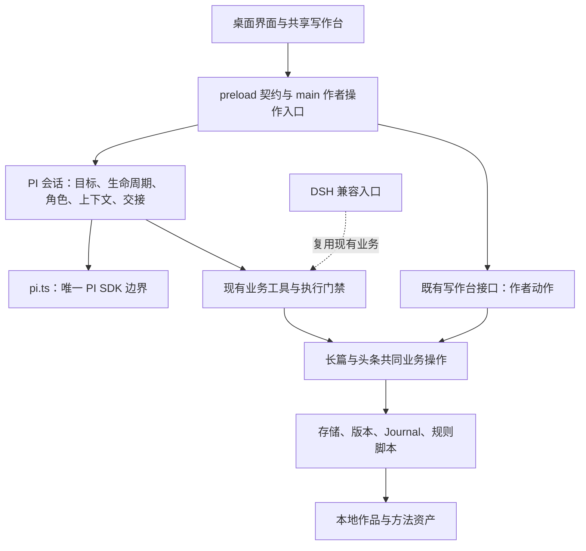

# 下一轮迭代报告：整体梳理、效率重构与精简验证

日期：2026-11-01。分析基线：`92f8d79a14b35632d9e2bbe9e00a6166a1530968`。

**本轮目标：在现有 PI 自有写作内核上，理顺整体框架，减少重复工作和维护负担，并以较少、有效的验证确保质量不降。**

状态：方案已开始实施，实际变更和验证状态见[实施记录](NEXT-ITERATION-IMPLEMENTATION.md)。方案制定时仅核对源码与既有记录；下文基线和未执行表保留制定时口径，执行状态以实施记录为准。本文不将局部改进写成整轮完成；不调整包版本，也不宣布 0.9.3 收官。

## 1. 需求与成功标准

这里的“准重构”是对现有系统做整体梳理和有依据的收敛：可以调整职责和调用关系，但以既有行为、磁盘数据和作者操作为基础，分步替换、逐步删除旧实现。

| 需求 | 必须达到的结果 | 判定依据 |
|---|---|---|
| N1 整体认知 | 能顺着界面、任务、工具、规则、存储追到实际入口和唯一责任方 | 架构图、关键调用链与代码一致；不再靠历次实施记录拼出现状 |
| N2 清理开发痕迹 | 产品入口没有测试专用导出、失效迁移分支和临时开发内容；当前文档讲当前系统 | 每一项删除都有引用或行为核对；必要诊断、授权和恢复记录保留 |
| N3 减少冗余 | 同一职责复用同一实现；同一构建任务在一次验证中只准备一次 | 列出实际删除或合并项、调用方及前后执行次数，而非只比较文件行数 |
| N4 提高效率 | 日常开发不再默认跑旧宿主全链路和整套发行打包；修改范围清楚 | 验证入口、触发条件和失败定位明确；记录真实耗时 |
| N5 优化性能 | 针对实测热点减少无效读取、重复投影或重复刷新，同时维持响应指标 | 同环境、同样本的前后记录；未测量的收益不宣称完成 |
| N6 精简测试 | 删除重复和依赖实现细节的检查，保留少量独立风险验证 | 删除项能指出保留的等价证据；不能靠合并名称伪装测试变少 |
| N7 质量不降 | 写作能力、作者权责、数据安全、旧作品和交付能力不回退 | 第 8 节质量条件全部核对，未具备条件的项目明确待验收 |
| N8 顺手交付 | 代码、脚本、文档和验收口径同步，不留下新旧两套长期并行实现 | 当前说明只有一个权威入口；临时兼容分支有明确使用方和退出条件 |

固定产品方向：自有桌面客户端 + 内置 PI + 长篇/头条两种写作业务。既有 DSH 只做存量兼容，不开展 MCP 或其他 Agent 工具适配。

## 2. 实际项目盘点

下列是静态盘点，不是性能瓶颈排名；文件大不自动等于设计差。

| 区域 | 当前事实 | 本轮判断 |
|---|---|---|
| 桌面会话 | `session.ts` 1,078 行，集中角色工具、主子会话、上下文、历史和结果交接 | 按真实职责收敛；先处理取消和规划交付缺口 |
| 桌面边界 | `main.ts` 829 行；`preload.ts` 多个参数/结果仍为 unknown；renderer 未纳入 TS 检查 | 优先明确 IPC 和作者动作契约，避免接口在三个位置分别猜测 |
| 桌面界面 | `client.jsx` 1,169 行；保存段落仍经全局事件、DOM 选择器点击 | 按状态归属拆分，使用显式动作；不规定必须拆成几个文件 |
| 长篇内核 | 110 个 TS 文件、约 16,418 行；已有 domain、ports、services、storage 和公开 facade | 先认清现有分层，复用共同操作；不再套一层“统一引擎” |
| 文件基础能力 | core 与长篇 storage 都有原子写、进程内串行化等实现 | 有合并候选，但同步落盘、安全路径、错误语义不同，不能直接替换 |
| 资源与读取 | 已有 `copyRuntimeAssets`、有界文件缓存、PI 历史缓存；桌面已禁用写作台轮询 | 保留并检查调用方；不把已有成果再写成新开发任务 |
| 构建 | `npm test` 中 build 已构建浏览器端，后续 build-bundle 又构建一次；两条 DSH headless 各自重新打包 | 有确定的重复工作，优先消除，不先建设复杂缓存系统 |
| CI | 每次 push/PR 均调度核心、DSH 全链路、Windows UI 和 Windows NSIS/ZIP 打包 | 按日常验证、桌面验证、正式交付分流，保留必要平台验证 |
| 测试 | 根 Node 95 条、桌面核心 6 条、GUI 3 条、DSH 集成 1 条，另有两条 headless；Python 215 个检查点 | 数量口径不同，不能简单相加为独立用例；先去重复准备和无效断言 |
| 测试侵入 | 引擎与浏览器入口有 `__testing`，core 有 `__resetSessions` | 测试直接导入实际模块或隔离进程，移除生产入口中的测试专用聚合出口 |
| 文档与元信息 | README、ARCHITECTURE 仍主要按 DSH 组织；STATUS 与部分验收行更新滞后 | 以自有客户端组织当前说明，历史记录与当前指南分开 |

本次对自有运行源码的标记扫描没有发现大面积临时 console 日志或 TODO 补丁。清理重点应是职责、测试出口、过期说明和重复路径，不能假设“开发痕迹”就是所有保护性代码。

## 3. 整体框架与责任归属

以下为目标责任关系，不要求按图新建包或搬动全部目录。

| 事实或决定 | 权威归属 | 其他层的职责 |
|---|---|---|
| 当前浏览对象、未保存缓冲区 | 界面状态 | 发送时形成任务快照；后续浏览不改变已接收任务 |
| 是否接收、准备、执行、等待确认、停止或结束 | PI 会话生命周期 | UI 展示事实，不从一句自然语言推断完成 |
| 角色可以调用什么 | 现有角色能力定义及执行检查 | 注册、执行和展示读取同一能力事实，不把工具注册当唯一防线 |
| 作者是否同意敏感动作 | 绑定对象、版本、参数的本次授权 | 门禁和存储前提共同生效；模型文字不构成授权 |
| 正文、候选、审读、规划是否保存 | 现有存储和实际产物回执 | 任务卡只引用真实对象及版本；不另建第二份作品事实库 |
| 方法与质检规则 | 原版/默认/用户方案、现有确定性规则 | 本轮整理加载和调用，不借重构改写方法、阈值或评分 |
| 当前系统怎么工作 | ARCHITECTURE、使用指南和当前状态 | 历次实施报告提供历史证据，不承担当前接口定义 |

保留现有包边界、公开工具名和作品格式。长篇与头条共用基础能力，但不强行统一不同的业务状态机。桌面的请求已在进程内复用写作台路由，不需要新建 HTTP 服务，也不为绕开路由再写一套业务。

## 4. 工作指导与实施范围

### W0：固定框架认知与质量基线

- 沿“长篇规划→候选→采纳→审读→作者定稿”和“头条立项→稿件→质检→记账/采用”追踪实际代码；再追一条停止和一条恢复路径。
- 在现有 `docs/ARCHITECTURE.md` 中补齐职责、调用链与事实归属，更新 STATUS；不新增另一套平行架构指南。
- 核对既有 0.9.3 验收证据，区分已实现、部分验证、未实现、平台未测。特别修正文档里“已修复”与“仍待修复”并存的行。
- 选取已有长篇、头条、方法方案和历史样本的副本；记录关键文件哈希、数据语义、构建次数和耗时。性能只采一组有效基线，不重复跑旧测试来填表。

交付：能解释整个系统的当前架构、明确保留的行为与未结案项。没有这一步，不开始批量搬文件或删测试。

### W1：先修真实缺口，再收敛会话职责

涉及：`apps/desktop/src/session.ts`、`context.ts`、`pi.ts`、现有角色工具定义。

- 取消：已有 signal 检查后仍会等待 `taskPrompt()`；等待期间停止，之后可能启动子 prompt。将“准备→启动→停止→清理”作为一个连续生命周期处理，并覆盖 SDK prompt 自身的启动时序。仅在 await 后补一个检查，不能代替完整时序判断。
- 规划交付：区分讨论建议和承诺保存的作品/根基/章纲/拆书结果。要求保存时给实际对象、版本、回执；未保存则如实标注。目录发生变化不等于完成了任务，不增加全目录指纹框架。
- 以会话管理为主体，把角色能力/工具装配、上下文准备、历史投影与产物核对整理为可独立理解的现有职责；提取只在确实改善调用关系时进行，不为每个函数创建类。
- 主子会话目前串行，不因假设中的并发把 Map 改成 Set。保留目标冻结、准备期代际标记、消息身份、清理及维护互斥，避免简化后重新引入误写。
- 当前长篇字符串错误已有 `exec.failure` 桥接。先为被修改的交付路径收敛结构化回执，不一次改写全部工具协议。

交付：调用方能明确识别任务状态和实际产物；停止后不再启动原任务的后续模型请求，已经完成的原子写入如实保留。

### W2：桌面边界类型化与显式交互

涉及：`main.ts`、`preload.ts`、`client.jsx`、`Workspace.jsx`、`Settings.jsx` 及共享写作台调用处。

- 在桌面源码内定义一份 IPC 请求、返回、事件及 `window.writerDesktop` 契约，main/preload/renderer 共用；外部输入按实际边界保留必要运行时校验。类型文件不引入 Node 到 renderer。
- main 保留桌面装配、窗口、系统能力和作者确认；设置、导出、作品请求等按现有职责整理。保留目前对写作台共同操作的复用。
- 去掉保存段落的 DOM 查询点击，目标选择和保存动作改为明确传递的回调/命令。共享组件只暴露实际所需能力，DSH 兼容在其既有外壳处理。
- 以真正拥有状态的组件/hook 收敛聊天、启动引导和工作区交互，避免同一状态在多处同步。不要为替代几个事件建设新的全局状态框架。
- 桌面自有渲染文件纳入类型检查，补齐必要的 React 类型依赖；不得用全局 any、`@ts-nocheck` 或关闭检查交差。共享 JSX 按实际边界补类型，不扩大为整库语法迁移。

交付：操作有明确调用方和责任方，作者保存/切页/停止语义不变，桌面渲染层检查实际生效。这继续落实原计划 R09，不能静默延期后宣称完成。

### W3：基础能力去重与数据读取优化

涉及：`core/fsx.ts`、长篇 `storage/primitives.ts`、`work-store.ts`、历史与面板读取处。

- 先对原子写和串行化列出契约差异：文件同步、临时文件排他创建、安全路径、错误码、键规范化和锁内重入。只有等价部分才下沉到 core；业务错误和数据前提保留在业务层。
- 长篇原子写包含 sync 和路径保护，不能直接换成较弱实现；本地时间与 UTC 输出也不能因函数同名直接统一。
- 区分进程内串行、跨进程资源锁、作品租约与 Journal。它们保护的范围不同，不作为“重复锁”删除；台账永久 `.lock` 文件不作为垃圾清理。
- 对历史新增消息后的读取、切换作品/会话的重复查询、面板所选范围读取做一次剖析。已有缓存、桌面停止轮询、按范围读取必须计入基线，避免重复开发。
- 确认存在热点后，在现有读取边界减少重复投影和 I/O；保留真实总数、PI 分支语义、消息过滤及文件替换/截断失效。授权、采纳、定稿和恢复仍读取实际依据，不以缓存命中代替完整性核验。

交付：被合并的能力有明确契约；收益记录执行次数和实测结果。若没有证据支持运行时热点优化，如实记录，不增加 Worker、索引库或新缓存层凑成果。

### W4：构建、资源与 CI 收敛

涉及：根/桌面 `package.json`、现有 build 脚本、`.github/workflows/ci.yml` 和 `release.yml`。

- 复用已有 `copyRuntimeAssets`，继续保证桌面与兼容包的方法、规则、默认方案、备份脚本和许可证齐全。
- 将准备产物与消费产物分开：同一 job 内，TS、浏览器模块、桌面测试模块和各目标资源按需要各准备一次；两条 headless 消费同一份本次构建的兼容包。
- 单独运行某个入口仍能正确准备依赖。不能仅凭“文件存在”跳过构建，也不建设跨平台自定义缓存服务；先用清楚的顺序和显式参数消除重复。
- 普通 push/PR 运行常规核心验证；桌面改动运行 Windows 桌面验证；兼容边界改动运行 DSH 兼容冒烟；发布或改动构建/资源/更新配置时运行完整交付验证。core、共享业务、工具执行、方法装载等变更也属于可能影响兼容边界的变更。
- 使用少量清晰的 workflow 条件；未知变更归为常规验证，依赖/工具链变更走相关完整验证。不要搭建智能测试选择系统。
- Windows UI 和打包可在同一验证流程复用同提交的 Windows 构建；Linux、Windows 的原生依赖与产物不混用。NSIS 和 ZIP 复用一次资源/Python 准备，分别核对交付文件。
- 发布前仍检查精确提交、标签、校验和、版本、资源和实际签名状态；不能为缩短 CI 删除这些检查。

交付：一次验证里不重复生成相同目标，普通代码提交不默认生成所有发行包。首次整理记录前后耗时与构建次数，后续不反复重测。

### W5：清理生产入口与当前说明

- 引擎测试改为导入 `allTools` 和实际 ports/services；界面测试导入实际组件或检查真实 GUI，随后删除入口的 `__testing` 聚合导出，避免为测试把内部对象留在交付入口。
- `__resetSessions` 所对应的重启验证优先使用真实进程隔离；若本来需要生产级释放能力，应按实际生命周期定义，不是给测试重置函数改个名字。
- 清查失效配置、重复默认值、无调用的旧分支和转发层：先查静态引用、动态装载、磁盘兼容及构建入口，再删除。兼容旧作品仍使用的路径不算无用代码。
- README、ARCHITECTURE、STATUS 改为自有客户端优先；根 package 描述同步实际产品定位。当前需求只描述仍有效的约定。
- 历史报告单独索引，移出当前导航的主线；不删除追溯记录。需要归档的文件先检查链接、构建和 release 工作流，发行脚本仍引用的版本实施记录保留稳定路径。
- 运行包继续排除测试、临时输出、开发证据和无关文档，保留方法正文、必要示例、来源和许可证。诊断信息说明用户遇到的问题，不向产品界面堆叠内部术语。

交付：产品源码与入口干净，历史可追溯，当前说明不用借助开发流水账才能理解。

## 5. 精简测试体系

### 5.1 只保留三类验证入口

以下命令名是本轮拟收敛的目标，当前尚未实现；尽量保留现有命令为薄别名，不增加新的测试框架。

| 目标入口 | 内容 | 什么时候执行 |
|---|---|---|
| `npm run verify` | 架构/类型/资产检查 + 必需 Node 风险验证 + Python 规则与桥接契约；按需要准备一次构建 | 日常变更稳定后一次；纯文档只检查格式/链接 |
| `npm run verify:desktop` | 真实 PI SDK + 本地可控模型 + 既有少量 Electron 场景；不重复跑基础验证 | 会话、IPC、界面、共享交互发生变化；以 Windows 为交付平台验证 |
| `npm run verify:release` | 消费已验证提交的产物做完整交付核对；必要兼容冒烟、安装/便携包、资源/Python/更新/签名状态 | 发布候选，或相关构建、资源及兼容边界变更 |

已在同提交、同输入和适用平台通过的前置结果可以复用；依赖、产物或代码变化会使相关结果失效。真实模型仍使用现有 `acceptance:run`，按阶段人工触发，不进入每次 PR。

### 5.2 每种风险在最能证明它的层验证

| 保留的风险组 | 主要证据位置 | 精简方式 |
|---|---|---|
| 授权、版本和角色权限 | core 门禁、共享工具执行、业务操作 | 保留绕过入口的反例；同一条件不在 fakeHost、HTTP、PI 三层各复制一整套 |
| 写入一致性、候选、恢复和旧格式 | 真实临时目录/文件及必要子进程 | 保留不同 Journal 和冲突语义，复用准备；不是只剩一条“写文件成功” |
| 头条状态、质检失效与台账幂等 | 业务集成与 Python 规则 | 一条主要闭环加独立失败条件；同稿件的多个规则断言复用一次输出 |
| 规划、角色交接、取消和重开 | 真实 PI SDK + 现有 fake-model | 模拟模型响应，不模拟被验证的会话/存储本身；仅补本轮实际缺口 |
| 文学规则与脚本协议 | Python 参数化样例、少量 Node 桥接 | 保留不同规则边界；减少解释器启动和重复样稿，不按断言数字删规则 |
| 方法、用户方案与交付完整性 | 资产检查、方案行为、打包后读取 | 清单负责全集与哈希，工具负责加载/覆盖语义，发行层负责包内路径；各自不重做全部工作 |
| 界面可用性与桌面集成 | 既有 3 条 GUI 场景 | 只检查用户能完成的操作与关键状态；不逐组件、逐文案写测试 |
| 存量 DSH 接入 | 原有集成与两条 headless | 集中到兼容/发行验证，复用一个包；不按新功能扩展旧宿主矩阵 |

### 5.3 对现有测试的具体处置

| 当前区域 | 处置 | 删除或合并的条件 |
|---|---|---|
| `unit` 与 `engine/domain` | 保留短小的独立边界检查；表驱动整理重复准备 | 只有输入、失败条件和保护行为都相同才去重 |
| `engine/storage` 19 条 | 优先保留高价值检查，合并同类 fixture/进程准备 | 各 Journal 中断与冲突不自动等价；未有替代证据不得删除 |
| `flow`、`fanqie`、`workflow`、`writer-layer` | 按业务/会话/兼容责任去掉跨层重复闭环 | 保留端口接线冒烟；底层覆盖不能证明上层真的接好了 |
| `methods`、`profiles`、`assets` | 分开全集完整性、方案行为、发行路径责任 | 固定文件数断言改为登记关系/行为核对；原版与默认用途不同，不视为重复资产 |
| 浏览器 VM、假 React 按钮树、文案/源码匹配 | 优先删除或替换为实际行为检查 | 必须先确保真实 GUI/组件检查覆盖对应状态；现有 GUI 未覆盖的头条操作不能裸删 |
| 桌面核心 6 条、GUI 3 条 | 优先复用，调整职责和共享样本 | GUI 不重测全部领域规则；核心不模拟界面布局 |
| Python 215 个检查点 | 按规则族和输入整理，复用结果 | 多个断言不等于多个独立场景；没有业务边界差异的重复变体才删 |
| DSH 集成与 headless | 保留兼容能力，移出普通变更的默认全跑链路 | 只移动执行频率不能计为“已删除测试” |

目标是验证更短、更易维护，**不设“必须砍掉一半”的无依据指标**。实施报告分别统计独立场景、断言、文件、准备次数和耗时；合并成一个大 test、隐藏在 helper、移出默认 CI 都不能冒充删除冗余。

新增验证原则：本轮优先复用现有测试，计划只为“取消交接”和“规划保存依据”补必要场景。发现其他真实独立风险时才追加，并写明现有检查为何不能发现；不为重命名、搬文件、简单组件拆分和每条 IPC 建测试。

### 5.4 执行纪律

1. 开发中只运行受影响检查；不每改几行就跑全仓。
2. 一个工作包稳定后跑一次其适用集合；通过且相关输入未变，不重复运行。
3. 失败时先定位原因，只重跑受影响项；不靠重试掩盖时序问题，不自动循环全套。
4. 候选提交只做一次组合验证，复用前面有效结果；平台不同仍按平台核对。
5. 不引入覆盖率 KPI、全仓快照、随机故障平台或新测试 DSL。固定样本的性能统计属于一次测量，不循环到“跑出好成绩”。

## 6. 性能与效率的验收口径

| 项目 | 基线现状 | 本轮目标/记录方式 |
|---|---|---|
| 重复构建 | 已静态确认 `npm test` 重建浏览器模块、headless 各自重打包 | 同 job、同目标、同输入只生成一次；记录前后次数与墙钟耗时 |
| 常规验证耗时 | 本次未测 | 同机器、依赖已安装、同等独立风险下比较前后；要求有实际下降，缺数据不能宣称提速 |
| 历史交互 | 已有 Linux Node 接口结果，但不含 Windows/IPC/渲染和新增 leaf | 沿用 A22：万条约 20 MiB、冷首批 ≤2 秒、热切换 P95 ≤500 ms、持续无响应 ≤1 秒、20 轮切换 RSS 增量 ≤50 MiB；按其固定次数执行一组 |
| 历史追加/切换热点 | 新 leaf 可能重投影完整分支；尚未测影响 | 比较相同输入下的投影、读取次数及界面可用时间；保留消息内容、身份、总数、分支正确性 |
| 任务到首个模型请求 | 尚无统一测量 | 同模型配置下单列本地准备耗时，避免将模型网络波动算成重构收益 |
| 运行包 | 资源已排除 tests，但尚未专项比对本轮产物 | 核对文件清单与体积，移除测试专用入口；不能靠删方法资产或必要资源缩包 |

不承诺未经测量的“快 30%”“百万字零卡顿”。若结构收益明确而运行时性能没有明显变化，分开报告；若本轮声明性能优化完成，必须提供对应热点的前后数据。

## 7. 质量保持与改进

以下条件是重构边界，也是最终验收依据：

- 数据：旧作品、头条台账、稿件历史、候选、方案和会话可读；不迁移格式，不覆盖作者缓冲区；失败和中断不伪装成成功。
- 权责：作者确认仍绑定本次实际对象/版本/参数；拒绝、取消、过期和重放不能写入敏感结果；角色权限不放宽。
- 一致性：原子写、跨进程互斥、版本冲突、审读失效、恢复前备份与完整性核对保持有效。多层保护有不同责任，不因为“去冗余”合并掉。
- 任务：浏览与执行目标隔离；停止后不再启动该任务后续工作；新对话和重开保留实际材料；结果卡与真实产物一致。
- 写作：保留原版/默认/用户方案及质检语义，头条硬闸不放松；语感扫描不冒充文学质量结论。
- 交付：桌面启动、内置 Python、中文/空格路径、导出、备份、更新和签名状态如实核对；既有 DSH 兼容不被无意破坏。

真实写作回归复用一份长篇存档和一篇头条稿，按相同方案、模型配置各完成一次关键修改/审读或质检/作者决定，比较实际产物和作者体验，不为每个重构步骤生成新稿集。

当前缺少完整真实模型与 Windows 基线，不能声称已证明“文学质量不降”或“Windows 性能已达标”。本轮的小样本回归也不能替代原 0.9.3 尚未完成的 E 集与交付验收；它们继续登记，避免一边精简测试一边悄悄降低正式发行标准。

质量提升应体现在本轮真实缺口被修复、错误交付更清楚、检查覆盖实际边界，而非测试数增加或规则变严。

## 8. 验收报告格式与当前状态

实施时直接更新下表并附一份简短执行记录，不再新增一套验收规范。最终每项写明：被测提交、实际观察、证据位置、通过/失败/未执行/受阻。以下“未执行”不是通过，也不是确认存在故障。

| 编号 | 验收项 | 必需证据 | 当前状态 |
|---|---|---|---|
| Q1 | 整体责任和当前文档统一 | 调用链与源码对应，过期状态修正；保留实际兼容边界 | 未执行 |
| Q2 | 会话取消与规划交付 | 准备期停止不启动后续请求；讨论/保存结果分别核对 | 未执行 |
| Q3 | 类型和交互边界 | renderer 实际纳入检查；保存和目标动作显式；无新增检查豁免 | 未执行 |
| Q4 | 基础能力去重安全 | 合并前后契约、调用方、错误和持久化保证；敏感依据不走缓存 | 未执行 |
| Q5 | 构建与验证更高效 | 同目标重复构建消除，验证入口/触发清楚，前后耗时 | 未执行 |
| Q6 | 测试少而有效 | 删除/合并项及等价证据；唯一风险未丢失；不增加测试框架 | 未执行 |
| Q7 | 产品无测试侵入 | 入口无测试专用聚合导出，包内无测试/临时证据；资源完整 | 未执行 |
| Q8 | 数据与作者权责不回退 | 版本/确认/并发/中断/恢复的有效既有证据及受影响复核 | 未执行 |
| Q9 | 性能正确且收益可核对 | 同环境样本、实际测量与范围；Windows/A22 单独记状态 | 未执行 |
| Q10 | 真实工作与交付可用 | 两种模式关键操作、旧作品副本、导出/备份/重开、适用平台产物 | 未执行 |

最终报告还必须列出：删除/合并的实际实现；保留但解释清楚的保护；重构前后测试与构建账目；尚未完成的原版验收；发现的问题及对应修复。不能把“测试全部通过”写成所有质量指标都通过。

当前报告交付结论：需求、框架、工作指导、测试精简规则和验收口径已形成；业务实施和收益验收尚未开始。

## 9. 执行顺序与停止扩张条件

按 W0 → W1 → W2 → W3/W4 → W5 → Q 项收尾推进。测试精简随对应代码一起完成，不等全仓改完再大删。每步是可独立审查、可回退的小提交，避免混入功能扩张、依赖升级或数据迁移。

优先级：先修真实取消/交付缺口，再理顺边界，再减少重复工作，最后核对交付和证据。W3 中无实测收益的优化可以停止，不影响已确定的 W4 效率工作。

新增包、后台常驻进程、全局状态框架或新持久化格式，必须先说明现有结构无法满足的具体需要；本报告没有这些需要，不列入默认实施。既有方法、业务能力和安全保护也不因“更简洁”而删除。

本轮完成要求：Q1—Q10 按实际适用范围有明确结果；无法核对的平台或真实质量单独保留待验收，不能宣布整体无回退。原 0.9.3 仍以其[计划](PLAN-0.9.3.md)、[验收规范](../0.9.3-ACCEPTANCE.md)与[验收报告](0.9.3-ACCEPTANCE-REPORT.md)追踪，不被这份报告重置。
