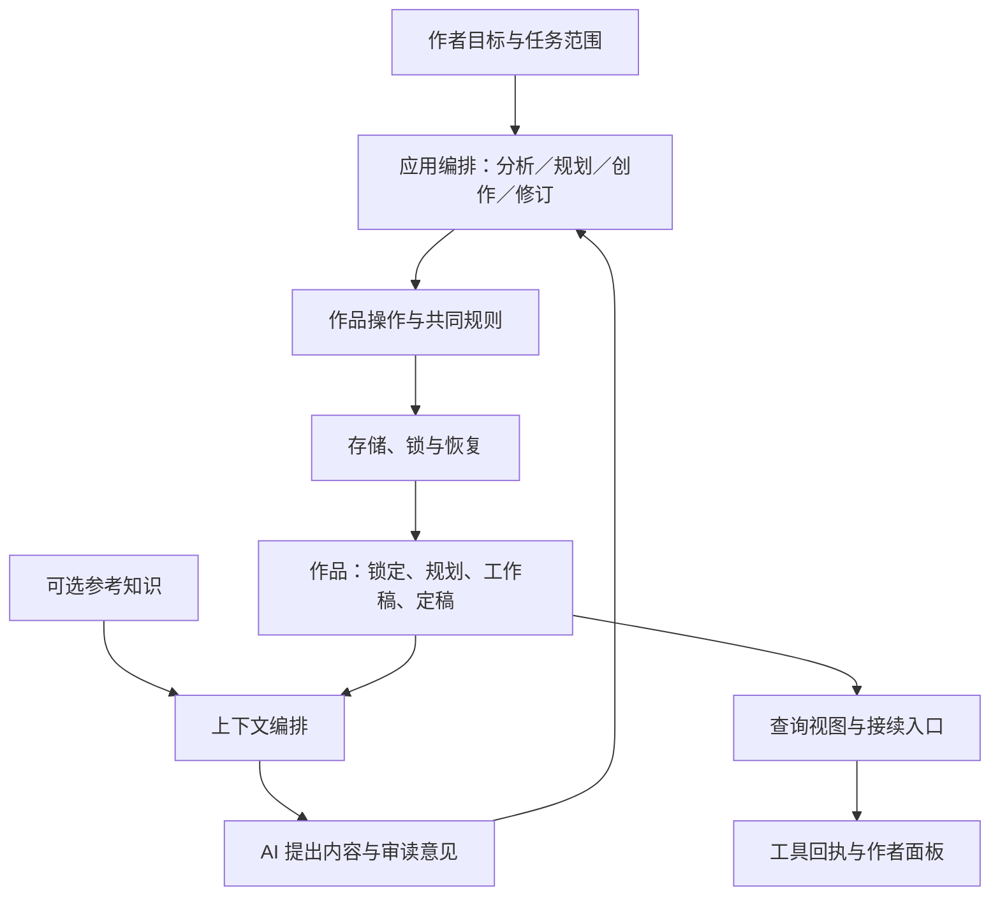

> 档案快照：保留当时的分析、计划或验证记录，不作为当前安装与使用要求。当前说明见[文档导航](../README.md)，版本变化见[CHANGELOG](../../CHANGELOG.md)。

# 织章整体深度优化计划

> 本方案的代码与兼容实现已推进至 0.18.0；实际交付和统一审查见 [IMPLEMENTATION.md](IMPLEMENTATION.md)，未具备的目标环境不冒称已验收。

日期：2026-10-27。代码基线：`cfc93a2` / 0.17.0。参考材料：用户上传的 `inspiration-forge-suite-1.3.0.zip`。

本文是待实施设计，不是完成声明。以作者长期创作一部作品的生命周期组织重构，局部缺陷作为设计验收证据，不按源码模块逐个打补丁。

阅读顺序：第 2–5 节确定产品与架构，第 6 节规定业务行为，第 7–9 节安排实施与验证，第 11–16 节给出操作契约、数据映射、系统支撑与交付清单。以本文件为总体方案入口，`ASSESSMENT.md` 提供现状和缺陷证据。

## 1. 材料范围与设计依据

附件包含 124 个文件，分为拆书、规划和正文写作三个技能。压缩包 SHA-256：`48049470dc49468787d1cf87c78a746419f111c40298740d551515a9181802ae`。

重点阅读：三个 `SKILL.md`，共用交接契约，拆解与规划工作流及方法论的主要章节，规划到写作交接、写作、连续性、修订、角色、编辑方法，以及章纲、当前状态、变更提案、精简拆解和字段模板；查看了两组教学案例的说明及部分修订示例，阅读归档与路径保护脚本。没有逐篇深读全部示范正文，没有执行附件脚本，没有验证其文学或市场效果。

三份交接契约字节一致，说明这套方案以共同契约连接不同角色。主要依据如下，路径相对技能套件根：

| 来源 | 吸收的设计 |
| --- | --- |
| `inspiration-forge/资产/交接契约.md` §1–7 | 按最终产物确定主责；最小交接；状态与授权分离；节奏档位；四态隔离 |
| `inspiration-forge-library/工作流.md`、`资产/拆解/字段规范.md` | 分析与入库分开；阅读范围和证据状态分开；字段按用途取用 |
| `inspiration-forge/工作流.md`、`资产/novel-writer交接格式.md` | 从目标倒推必要上游；章纲足以开写；同作品根直接消费现行规划 |
| `novel-writer/references/pipeline_handoff.md`、`continuity.md` | 前章全文与有出处增量；定稿快照；候选依赖；正文只回传相关未来规划 |
| `novel-writer/references/editor_method.md` | 四类内容核验；L1–L3 阅读损失；先读后改再完整回读 |
| `novel-writer/references/revision.md`、`scripts/archive_draft.py` | 原稿基线、历史保留、已审字节、独立授权、唯一现行正文 |

附件中的指令是本次分析材料，不直接触发写小说、建立知识库、归档、委派或平台操作。这里选择其适合织章的契约；不会把 Python 脚本直接接到 TypeScript 存储旁边形成第二个写入者。未来若分发其文字或代码，保留相应许可与来源。

## 2. 顶层目标：维护可持续演进的作品现场

织章的核心交付是：作者随时知道当前作品写到哪里、下一步依据什么、哪些只是方案、哪些变化需要自己决定；AI 能用必要且准确的上下文继续创作。

衡量优化的四个结果：

1. **能接续**：跨会话不靠重放聊天，能恢复规划进度、实际正文和下一步。
2. **能创作**：上下文给足关键经历与知识边界，保留措辞、对白和现场发挥空间。
3. **能修订**：知道改动影响什么，防止旧候选覆盖新稿，不自动篡改后续作品。
4. **负担适当**：简单分析、单章写作、完整拆解分别付出对应成本。

保留 DSH 插件、本地可读文件、按需启用、AI 交内容、代码管工程的基本形态。目标不包含自动写作引擎、平台投稿、全量故事知识图谱或新的任务管理平台。

## 3. 对当前整体设计的关键调整

| 当前倾向 | 目标设计 | 全局影响 |
| --- | --- | --- |
| 拆书到写作被描述为统一默认长链 | 按用户最终产物进入分析、规划、写作、修订 | Scheduler、系统提示、回执和面板共同调整；已充分的上游直接复用 |
| 采纳草稿后自动补 happened | 定稿事实快照与工作接续分开 | 采纳、简报、状态、连续写作、汇编共同区分事实与候选 |
| 近期 brief 和 lint 凭据承担较多门禁职责 | 使用依据版本、真实审读和授权各有独立含义 | 时间记录不证明材料仍新鲜；词表扫描不证明内容审读 |
| 编辑围绕润色模式、比例和禁句展开 | 先定位内容问题和阅读损失，再按授权决定改动 | 统一方法资产、编辑 brief、质量策略、诊断回执 |
| 各入口组织自己的写入和恢复 | 共同作品操作决定语义，存储执行已确定的意图 | 工具和面板共享定稿、修订、冲突、提交结果 |
| 文件拆分是主要重构手段 | 先定义信息权威、操作契约与影响范围 | 根据完整业务行为调整依赖，不按文件行数重排 |

其中最重要的取舍：**已采纳草稿可以供下一章条件接续，但只有定稿内容进入定稿事实快照。** 这样既不要求每章先定稿才能连写，也不把未定稿方案误认成已经确定的故事。

## 4. 一套共同语义

### 4.1 不把所有状态压成一个 status

- 证据身份：可核文本事实、分析推断、待验证；阅读另记目录扫描、正文已读、深读、未读。
- 作品材料：已发生、作者锁定、当前采用、候选。锁定约束不等于已发生，采用方案不等于已经写出。
- 正文流程：候选 → 当前工作稿 → 当前版本已审 → 定稿。编辑不通过可继续保留草稿；没有自动晋级。
- 授权范围：真实任务允许分析、规划、修改、采纳还是定稿，以及目标范围。审读通过和程序布尔值均不能制造授权。

这些是不同问题，不做全对象通用的巨大枚举或数据库。保留现有章节状态，通过明确类型、必要的可选记录和回执表达差异。

### 4.2 权威与冲突

作者锁定是创作边界；定稿正文是已发生叙事的主要依据，仍须区别人物说法、客观发生、读者揭示和人物获知。两者冲突，定位到相关范围由作者决定，不能自动挑一方覆盖。

规划与卡提供设计依据；快照、brief、索引和面板是派生材料。派生内容落后时核实际来源后修正，不能反向改正文救快照。不能从字词匹配自动判定人物知道什么，也不能从三步技法推断已经取得读者效果。

### 4.3 成功的共同含义

一次作品操作先明确哪些变化必须共同成立：例如当前正文、章节目录、采纳标识及核心操作留痕。它们需要同一恢复意图。普通统计或诊断记录可以独立失败，但回执必须说明实际写入状态。

统一返回三类业务结果：已完成、尚未写入而被拒绝、存在待核对/恢复的部分状态。保留具体错误码；禁止工具显示失败而无说明地留下已修改正文。

## 5. 围绕作品的目标结构

这里的 AI 是宿主 Agent 的职责，不表示插件新增模型调用。

| 职责边界 | 负责 | 不能代替的工作 |
| --- | --- | --- |
| 参考知识 | 来源、覆盖、证据、分析成果与卡 | 不写本书事实、不自动开展原创规划 |
| 作品操作 | 应用规划、采纳工作稿、记录审读、定稿、修订 | 不用词表代替文学判断 |
| 上下文编排 | 相关锁定、现行纲、前章全文、状态增量、风格与按需方法 | 不重新设计关键因果、不漏标候选依赖 |
| 应用编排 | 任务范围、输入版本、业务交接、提交范围及回执 | 不另造一套底层文件格式或文学评分 |
| 存储恢复 | 格式、路径、锁、意图、冲突、原子替换和版本兼容 | 不引用面板或业务导航来决定写入含义 |
| 查询与交互 | 作者视图、工具参数、访问控制、提示与导航 | 不另写采纳、修订和定稿规则 |

沿用现有 Ports 和公开 API，不为名称整齐批量改名。内部职责调整后，依赖方向应是“入口 → 应用操作 → 领域规则/存储接口”，查询视图独立读取；移除 `store → panel-enrich → Ports → store` 回路。

## 6. 核心能力如何一起改变

### 6.1 参考：轻量分析与正式入库分开

局部分析默认交自足短报告和少量实用技法，不要求先导入公共库、跑全部事实/聚合层或凑满维度。分析成果可以保存为工作材料，显式授权入库时再转换成符合库规则的候选卡。

完整拆解继续支持现有九步、分批取文和 Full 确认；用户要求全量时不能自行缩为抽样。计划、已交付文本、阅读申报、证据复核各自记录，不把任何一项冒充实际理解。

证据定位同时记录来源版本与实际位置，显示章号作为阅读导航；遇到重复章号、番外或作者注，不能仅按章号覆盖记录。原文变化时标记相关引用需要重核，不自动把旧分析升级为新版本已核。

迁移包表达：要解决的阅读问题、可迁移体验、可执行做法、必须重造的人物欲望/能力边界/对手筹码、主动舍弃内容、失效条件。保留 craft/mind 作为参考用途，但组合中的“恰好一张 mind”等数量要求改成推荐，不阻断材料充分的原创推导。

引文存在、路径有效可硬校验；心理/评价词等语义启发改为提示。无读者数据不把“为什么可能起效”写成实测成功。已有置信度加权值改以覆盖和证据明细为主，旧数值兼容展示且明确不代表正确率。

### 6.2 规划：倒推最小上游，交出可开写依据

只要章纲就补够本段必要依据；请求全书规划则覆盖全部约定范围，再按单元细化。单卷不强建卷文件，单章材料充分不强建幕文件。

章纲的内容契约吸收四项头注和四块正文：视角、篇幅、锁定、人物知识边界，以及梗概、冲突与看点、推进节点、章末落点。映射现有 Outline，允许保留作者完整 Markdown 原稿；不维护两份可分别编辑的权威章纲。

本章必要时说明人物当下所求、对手按已知作出的回应、卖点改变局面的关键一拍、主要亲历场面、可压缩过场与不能删除的转向依据。它们是内容方法，不新增每节点必填格、固定场数或强制钩子门禁。

书级节奏与风格一次记录，卷/幕可有注明的局部选择；未确认的默认建议不自动变为作者锁定。平台政策作为带日期、来源的可更新参考，附件中的节点数字本次没有独立核验，不写入固定硬规则。

### 6.3 上下文：给足现场，控制无关负担

统一生成语义明确的上下文包，供 chapter_brief、编辑与连续写作按需投影：本章采用纲、相关锁定、前章正文、相关单元、快照及其后的必要出处、本书讲法与可选参考。

前章若未定稿，明确标成所依赖的工作稿/候选版本；不能作为定稿事实快照的一部分。普通续写使用定稿前章或显式采用的工作分支，不能按“最新文件”静默切换。

普通篇幅前章给全文；超长材料如受工具返回限制而截断，必须标明缺口并提供读取剩余原文的入口，关键依据未补齐前不能声称已经满足完整接续。不以简单增加所有返回上限代替上下文设计。

brief 的存在时间只作操作信息；必要输入指纹用于识别准备材料是否已变化。内容充分就沿用，不因超过固定 12 小时要求重复取文；真实冲突只阻塞依赖项。

方法资产按任务加载：写手拿写作方法，编辑拿审读方法，分析拿证据与迁移方法。既有方法包与本书风格分开，避免启用时把全套技能文字常驻注入。

### 6.4 写作、审读与定稿：分别表达三种结果

普通写作交候选/工作稿，不因生成完成或扫描零命中自动定稿。候选采纳与直接保存共同调用作品操作，定稿覆盖保护、输入版本和提交结果完全一致。

建议默认链收敛为“获取上下文 → 暂存候选 → 采纳工作稿”。低成本词表扫描可在采纳内部对当前字节执行，现有显式 style_lint 保留为提前诊断；提供旧 token 时仍核匹配，不能静默接受错误凭据。这样去掉一次纯为签令牌的必经往返，同时保留诊断能力。此变更需与系统提示、Scheduler 和兼容工具在同一阶段完成。

内容回读属于创作职责，可由同一 Agent 先写后审，不强制多代理。定稿要分别满足：已有范围授权、当前内容版本有审读记录、没有未解决的内容阻塞。记录审读的主体、范围、依据版本、结果与已审正文指纹；记录只能证明提交了什么声明，不能证明客观文学质量。

机械扫描凭据不能转换成人工或模型审读凭据。默认不增加每章深度编辑，用户要求深改或发现真实问题时才进入编辑流程。已有 A/B/C 工具保留为兼容交互，不要求用户反复说固定确认词；本轮已明确授权的范围内直接执行。

编辑采用四类内容核验与 L1–L3 症状定位。润色范围不擅自改路线，获准结构重构就真正处理因果和场面问题；字数压缩比例、禁句和“结尾必须留物件”改成按本书目标选用的参考。保留直接心理、安静收束、人物长句与热烈群体反应的空间。

### 6.5 状态与修订：一个现行版本，有限影响传播

恢复入口分三部分：规划完成与剩余、定稿正文快照、工作稿/候选依赖与待决。快照有截至位置和必要来源，批次/单元末或跨会话需要时更新，不自动写逐章流水。

现有 happened 不删除。无来源标记的旧文本按作者材料保留，不能自动认定为机器摘要或定稿事实。先增加最小的可选来源标记，能明确判断的派生摘要才自动提示过期；作者手写内容提示核对。

修订完整流程：定位原稿与授权 → 保留不可覆盖历史 → 新候选及差异 → 审读当前候选 → 再核原稿基线 → 应用已审内容 → 验证实际字节 → 标记相关派生内容待核对。新增必要 revision 历史区，但只保留一份现行正文路径，历史不参与快照和汇编。

影响传播先覆盖明确关联：前章正文、所用规划、编辑父稿、连续草稿依赖和摘要来源。无法确定语义影响时说明需要人工核对，不宣称算法识别全部伏笔。修改过去章节不能自动重写未来定稿；与作者锁定冲突由作者裁决。

### 6.6 工程保证与作者视图

共同作品操作可按行为组织为 applyPlanning、acceptDraft、recordReview、finalizeChapter、reviseChapter；这是内部职责，不要求新增同名公开工具。直接保存进入这些语义边界，明确元数据修改与正文修改的差别。

在锁内核版本与必要资产，再创建已知目标白名单的写入意图。基础文件快照/哈希从 accept-journal 中下沉为无业务依赖的基元；再逐类复用验证、分类、应用和清理执行机制。八种旧恢复格式保持可读，不一开始重写全部协议。

路径保护统一覆盖父目录及链接别名，明确支持的本地文件系统前提。保留合作进程锁和冲突核对；不将 rename 宣称为 compare-and-swap，不假称消除了外部竞态。中断、遗留锁和恢复记录的关系给出可操作提示。

面板优先回答：当前采用什么、定稿到哪里、哪些候选可比较、哪些结论过期、下一步需要做什么。缺失、损坏、待恢复与过期分别显示。面板和工具复用领域操作，但 HTTP 的 Host、Origin 与令牌校验保留在访问边界独立加固。

## 7. 分阶段实施：每阶段贯通一条完整行为

| 阶段 | 完整交付 | 牵动范围 | 完成判据 |
| --- | --- | --- | --- |
| P0 共同契约 | 状态/权威表、操作表、旧字段映射、入口与副作用清单 | 工具、面板、作品、库、状态、恢复 | 每条核心规则都有拥有者、输入、结果与旧数据处理办法 |
| P1 一次可靠修订 | 第三章改动后安全落稿、保留历史、标记旧审读和相关接续待核对 | 公共操作、章节、采纳、直接保存、恢复、查询 | 入口行为一致；旧候选拒覆盖；失败无假回执；旧定稿有历史 |
| P2 一次可靠接续 | 同部作品跨会话恢复并连写两章，未定稿依赖明确 | 上下文、快照、方法资产、审读、定稿、面板 | 计划与事实分离；前稿变化只触发相应依赖；无需整书重读 |
| P3 一次有效迁移 | 对指定片段轻量分析，按需入库，转成原创章纲并交写作 | 分析、卡、规划、上下文、范围导航 | 无库仍可工作；参考不变成本书事实；关键因果足以开写 |
| P4 精简与交付 | 清理旧门禁/提示重复、打断依赖回路、核对兼容及发行 | Ports、Store、HTTP、客户端、文档、dist | 一个导航口径、一套写入规则、旧资产可读、现有构建检查通过 |

阶段有依赖顺序，但实现不先横向重写所有基础层。P1 只提取贯通修订所需的共同能力，P2/P3 再补各自所需，P4 根据已经稳定的职责收尾。每阶段列完成与剩余，不以一条演示成功冒充全范围完成。

## 8. 兼容与数据演进

- 保留公开工具名、默认存储根及现有 Markdown/JSON 资产；新增字段以可选、带版本的记录为主，现有调用走适配器。
- 现有 final 作为历史已定稿状态保留，不补造审读与授权证据，也不要求全库重新审稿；新修订遵循新规则。
- 无标记的 happened、旧卡阅读信息、缺 planning 的作品继续可读，未知保持未知；不批量改名或自动按模板重写。
- 更新前检查未完成恢复记录；旧操作按旧协议完成或明确保留断点，不能用新格式猜测覆盖。共享执行机制改动须保持每类旧意图的目标白名单。
- 先做受控备份和兼容样本验证，再考虑显式迁移。兼容失败保留原资产，不能用静默降级为空内容来维持界面。
- 源码和 tracked dist 同步构建；文档、工具回执、Scheduler、质量提示必须随语义一起更新。附件目录布局作为语义参考，不原样另建第二套作品根。

## 9. 简单均衡的验证方案

继续使用现有 domain、workflow、storage、panel 四个测试文件和一个 `npm run check`，不增加独立烟测和长篇端到端脚本，不预设用例数量指标。

自动验证重点：状态转换和权限范围、基准及审读版本、共同提交与故障恢复、坏资产可见、不同入口结果一致、旧格式可读。现有重复用例先合并，新增只针对新增契约或真实风险。

保留两条短组合行为作为连接验证：

1. 旧章授权修订 → 旧候选被阻止 → 状态待核对 → 新 brief 引用新版本 → 汇编使用现行正文。
2. 不入库的片段分析 → 按需采纳技法 → 本书章纲 → 两章条件接续 → 在授权内定稿。

文学行为另作少量案例评阅：快爽、稳推/慢燃、安静关系或完整收束、人物误知与不可靠自述；检查是否保住因果、知识边界、实际变化与本书讲法。附件教学案例可以用于比较方法，不能当作已有市场成功证据。保存问题、依据与修改理由，不用词频或总分充当文学验收。

版本绑定、恢复和语义测试各证明各自范围。真实 DSH、Node 最低支持版本、Windows 路径及链接行为在目标环境验收；本计划没有宣称它们已经通过。

## 10. 本轮产物与开工条件

本轮完成附件核心契约与织章现状的对照、关键取舍、目标边界、阶段安排及验收设计，未改业务代码、未执行附件脚本、未进行数据迁移。

实施前先完成 P0 的具体操作与字段映射，并用 P1 的修订案例逐项走查。只有规则和数据归属明确后才开始修改；遇到局部缺陷，先定位它违反哪条共同契约以及牵动哪些入口，再在对应完整行为里修复。

## 11. 核心业务操作契约

下表明确工程责任，后续实现可以保留现有函数名。所有写操作先解析实际作品上下文，再在相关资源锁内复核依据；界面确认是入口交互，业务规则在共同操作层执行。

| 操作 | 最小输入与前提 | 共同成立的结果 | 冲突处理 |
| --- | --- | --- | --- |
| 保存分析成果 | 指定材料、版本、阅读范围、本轮问题 | 工作成果与来源声明；公共库不变化 | 原文版本变化标需重核，不能静默提升证据状态 |
| 采纳参考卡 | 当前候选、指定来源、入库授权范围 | 卡、库索引、候选采纳标记一致 | 原文或候选变化停止采纳，保留分析成果 |
| 应用规划 | 当前方案、目标作品、所依赖规划版本及范围 | 对应规划、必要章纲、来源与应用标记一致 | 与锁定/定稿冲突交作者处理，无关规划保留 |
| 暂存正文候选 | 目标章、正文、目标章基线、实际采用的依据 | 候选正文与元数据一致，正式章不变化 | 旧依据可保存为候选，但明确不能直接应用 |
| 采纳工作稿 | 当前候选、目标基线、采用范围 | 正文、章节目录、采纳标记、必要留痕及依赖状态一致 | 基线变化拒绝覆盖；final 目标走修订语义 |
| 直接保存正文 | 当前目标、正文或元数据修改、修改范围 | 正文修改遵守共同采纳/修订规则；元数据修改保留正文 | 不再按字数决定能否绕开定稿与基线保护 |
| 记录审读 | 已读正文指纹、相关依据、主体、结果与问题 | 审读绑定指定版本；扫描记录保持独立 | 旧版本记录保留为历史，不迁移到新正文 |
| 定稿 | 当前工作稿、当前审读、实际授权 | 状态与核心留痕一致；只定稿已审内容 | 未授权或版本变化保留工作稿；不能临时计算新 hash 冒充重审 |
| 修订定稿 | 原稿基线、授权范围、历史副本、已审候选 | 可读历史、唯一现行正文、新版本状态及影响提示一致 | 已有外部改动不覆盖；部分写入转明确恢复状态 |
| 更新快照 | 定稿来源、截至范围、派生内容及作者手写分区 | 只更新明确的派生区域，保留规划与待决 | 证据不充分保留原内容并标待核对 |
| 汇编 | 作品、筛选范围、输出位置、读取版本清单 | 一个可识别来源的完整汇编文件 | 坏章/缺章停止，保留旧输出；待核对信息明确呈现 |

元数据更新也可能改变含义：位置变化影响前后章关系，章纲变化影响创作依据。它们不必使正文自动失效，但要重算明确的上下文关系。标题等展示变化不无差别触发全文重审。

审读结果与适用性分别表达：正文变了，旧审读不适用于新正文；正文没变但关键依据变了，记录“依据待核对”，不伪造它已重新审过。模型提交“已回读”的记录是声明，系统只能核验所绑定版本与结构，不能证明阅读实际发生。

## 12. 最小数据契约及旧字段映射

只给真正参与操作的对象增加身份、来源和版本，避免把每一行小说变成结构化实体。

| 对象 | 保留的现行数据 | 必要补充 | 旧数据策略 |
| --- | --- | --- | --- |
| 作品 | key、标题、foundation、chapters、pace、planning | 为实际 planning 补齐类型；书级有效风格与任务范围有明确入口 | 缺字段保持缺省，未知扩展字段保留 |
| 章纲 | Outline 的视角、knowledge、synopsis、conflict、beats、ending 等 | 采用状态与必要来源；完整作者原稿需要时可保留 | 结构字段与原稿必须指定唯一编辑权威，另一种作为投影 |
| 正文候选 | id、chapterId、bodyFile、editOf、unifyOf、lint 记录 | 目标基线指纹、实际使用的输入引用、条件前稿引用 | 无基线的旧候选可读、可比较；应用前明确核对当前目标，不自动认定新鲜 |
| 正文章节 | 当前路径、正文、章纲、状态 | 内容版本指纹与必要审读关联 | 旧 final 保留历史含义，不伪造证据 |
| 审读记录 | 可复用 ledger 的记录入口 | 正文指纹、依据引用、审读主体与结果、阻塞项 | 与 style_lint 分开，不能从旧扫描 token 合成审读 |
| 接续状态 | foundation 的现行作者材料 | 定稿快照、规划进度、条件依赖、必要待决的独立分区 | happened 默认保留原文和未知来源身份 |
| 修订历史 | 现有候选历史 | 独占的原稿字节、前后版本、差异摘要、操作关联 | 不复制为第二份现行正文，不参与普通枚举汇编 |
| 参考证据 | source、卡、阅读范围与引文 | 来源版本、位置及事实/解释身份 | 不推断旧卡已经深读，不按重号覆盖证据 |

引用只需能定位目标及修订，例如对象种类、作品/来源、实际位置、内容指纹和用途。内容指纹用统一字节定义；作品正文正文体、整份文件、规划字段分别明确用途，不混用。展示元数据变化和正文变化分开比较。

不把整个作品塞进一个巨型事务：作品采纳锁住相应作品；库采纳锁住库；跨灵感与作品的操作有固定锁顺序和已知目标清单。派生视图按提交结果读取，不能看到半完成操作却当作正常空内容。

## 13. 修订影响传播与恢复模型

| 变化 | 必须检查 | 保持原样直到明确决定 |
| --- | --- | --- |
| 本章工作稿改变 | 本章扫描/审读适用性、编辑子稿、直接依赖它的连续草稿 | 无关章及其定稿状态 |
| 已定稿章获准修订 | 历史、当前审定状态、相关快照、直接接续依据、已知下游引用 | 后续已定稿正文，不自动倒改 |
| 本章采用纲改变 | 本章准备材料与审读依据、显式依赖该纲的候选 | 已写正文，不自动按新纲重写 |
| 作者锁定改变 | 显式引用的规划和章的待核对提示 | 所有历史原文与原审读记录 |
| 参考来源/卡改变 | 相关证据、未来使用时的版本提示 | 已采纳作品内容，不因参考更新自动变更 |
| 顺序或归属改变 | 前后章关系、关联卷幕上下文、汇编顺序 | 正文内容本身 |

“待核对”是影响提示，不等于已知有错。先跟踪明确引用；语义影响未知时指出范围，不构造可靠性未经验证的自动因果图。不同关联因用途不同可以有不同严重度，不能把所有变化都变成全书硬阻塞。

恢复对用户统一为：读取可用状态 → 检查未完成操作 → 核冲突 → 完成原意图或保留人工处理断点。已有命令作为入口兼容，回执显示本次操作及各文件的实际状态。

遗留锁处理与 journal 恢复区分：先核写入者，再处理锁，最后恢复；不凭超时删除。历史副本完整性也是修订前提。恢复过程中再次冲突就停止，不自动用备份覆盖可能由作者更新的现行稿。

旧意图格式由兼容解码器处理，共同执行机制只接收已验证的固定目标。读写新记录必须有格式版本，不允许任意外部 JSON 指定文件路径执行。

## 14. 宿主、会话、面板与运行支撑

### 14.1 宿主和会话

保持未启用时只注册 enable、启用后挂载当前 Agent 工具与必要提示。注册失败可完整撤销，重复启用不重复挂载。上下文与配置从实际调用实例传递，避免多个实例或多个会话被最后一次全局配置覆盖。

明确作品选择依据：本次显式选择优先，其次本会话所选作品，只有唯一作品时可自动选择；多作品不猜。面板可选项目不能因另一会话的“最近根”变动而静默切换。持久化最近根只作为可见的发现入口，不赋予访问或写入授权。

存储根、作品根、公共库根和源书目录分别解析，环境变量与配置优先级统一给工具和 HTTP 使用。显示实际解析来源；显式路径失效不悄悄切到新空目录。公共库可跨作品共享，本书状态不能跨作品串用。

### 14.2 作者工作台

保留阅读、候选对照和采纳为主视图，增加必要的版本、审读适用性和影响提示。管线视图展示相关任务与缺口，不要求作者理解 journal、Ports 或内部 token。

采纳前能看清目标和替换范围；候选已过期、定稿需修订、资产不可读等各有明确状态。网络重试不靠再次写入解决：返回已提交或待恢复的操作状态，避免用户因超时重复操作。

规划先实现可靠阅读与工具修改，不在本轮扩张为完整可视化规划编辑器。客户端按职责拆出请求、状态与正文渲染即可，不引入新的前端框架作为重构前提。

### 14.3 访问边界和性能

HTTP 对本机与 LAN 分别定义可信 Host、Origin 与配置令牌规则，自定义宿主/代理通过明确配置接入。配置令牌后是否适用于本机必须语义明确，不能把相同 Host/Origin 当作可信来源证明。保留请求体限制、限流、正文安全渲染和错误状态区分。

性能先记录代表性单书和共享库的快照耗时、正文返回大小、缓存占用与写操作耗时；不凭推测重写查询层。面板继续按需取正文，大库可按测量结果加入有稳定顺序的分页/增量查询。缓存不参与采纳或恢复的完整性证明。

### 14.4 交付与备份

保留离线显式备份和校验，不自动恢复。作品、灵感及独立公共库的备份范围一起说明，记录配置指向，避免只备份默认根而漏真实资产。

发布核对版本、源码与 dist、包入口、客户端、文档和恢复兼容。CI 直接运行现有 `npm run check`；平台差异验证集中覆盖声明支持的 Node 和目标文件系统，不新增一组与本地脚本重复的长流程。

## 15. 实施工作包及退出条件

| 工作包 | 前置 | 产物与影响范围 | 退出条件 |
| --- | --- | --- | --- |
| A 契约落位 | 总体方案 | 为现有所有写入口与关键读入口标注业务操作、权威数据和副作用；确认本文字段映射 | 没有“某入口例外绕开领域规则”的未说明路径 |
| B 修订贯通 | A | 公共操作、基线与历史、共同提交、坏资产提示、实际回执、HTTP 来源修正 | 直接保存/工具采纳/面板对同一修订结果一致；故障可核对 |
| C 接续贯通 | B | 审读版本、定稿与条件草稿、状态分区、上下文包、方法按需加载 | 两章连续写作可恢复，前稿变更不污染定稿事实 |
| D 参考迁移贯通 | A、C 的交接契约 | 轻量分析、正式入库、机制迁移、可开写章纲、按目的导航 | 纯分析不改库；无卡能规划；参考身份与作者规划分离 |
| E 收敛与发布 | B–D | 旧适配、恢复公共机制、查询依赖、配置作用域、面板与文档、构建产物 | 剩余依赖环有明确清单；关键边界单向；兼容与交付检查通过 |

每个工作包结束时交出：实际改变的完整行为、涉及入口与资产、验证证据、已完成及未完成项。出现新问题先归入对应契约，禁止随手增加临时旁路。若需改变公开语义，在同一工作包同步工具、提示、回执、面板与文档。

不在此阶段承诺未经拆解的工期。工作包按依赖推进，不以文件数量或提交次数判断完成。

## 16. 验收矩阵与范围控制

| 全局约束 | 自动验证位置 | 人工/目标环境验证 |
| --- | --- | --- |
| 参考与本书事实分离 | workflow：不入库分析、迁移与规划应用 | 原文证据和迁移做法是否可用 |
| 草稿与定稿分别接续 | domain/workflow：状态与条件依赖 | 两章连读是否接住实际场面 |
| 审读绑定实际版本 | domain/storage：正文和依据变化 | 审读报告是否给出实际问题与依据 |
| 定稿及修订范围一致 | storage/panel：基线、入口一致与历史 | 作者看到的替换范围是否清楚 |
| 故障不产生假结果 | storage：失败注入、旧意图恢复、重复操作 | 遗留锁提示与人工核对是否可执行 |
| 异常资产可见 | storage/panel：损坏、缺失、待恢复、过期 | 面板能否定位问题且保留其他可读内容 |
| 配置与访问隔离 | workflow/panel：会话选择、Host/Origin/令牌 | 真实 DSH 装载、代理及 LAN 配置 |
| 旧资产与发行可用 | 现有测试、构建、包清单与兼容样本 | Windows 路径/链接、最低支持 Node |

内容评阅选择少量代表性材料，不新增文学评分引擎。测试按可观察行为合并，故障注入只覆盖核心提交与恢复，不为每个内部函数造镜像用例。

本轮纳入：共同操作、版本与审读、定稿/工作接续、修订影响、轻量分析、规划交接、提示方法、存储恢复、入口一致性、配置作用域、面板状态和交付兼容。

后置能力：全景故事图谱、自动追踪全部人物知识、自动判断文学效果、整书自动重写、全套规划可视化编辑、平台发布、完整外部技能运行时。这些不应成为本轮重构的隐藏依赖。

最终完成标准：作者能从当前作品恢复工作，能看清候选与定稿的区别，修改后知道哪些依据待核对；工具和面板对同一操作结果一致；核心操作中断后可识别与恢复；旧资产没有被静默覆盖或降级；日常任务保持短路径。
